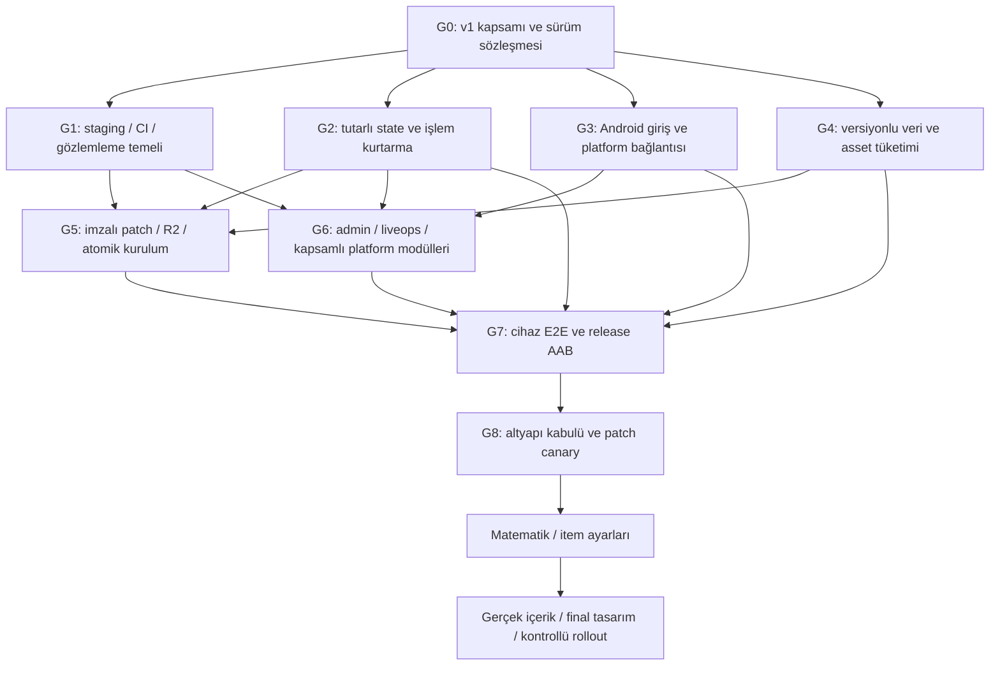

# Altyapı yol haritası — AAB ve içerik patch'leri

Tarih: 2026-10-04. Başlangıç: `main@bdd3e19e395f73f7c2bdff5966e20a74ae986123`.

> **Kaynak.** Bu belge sahibinin 2026-10-04'te oturuma verdiği yol haritasıdır (Codex incelemesi); metin aynen
> korunmuştur. Tek değişiklik: başa eklenen **Durum** bölümü. Backlog'un tek kaynağı bu dosyadaki INF kimlikleridir.
>
> **Eksik kaynak.** Metin, bulguların ve kanıtların [INFRASTRUCTURE_REVIEW.md](INFRASTRUCTURE_REVIEW.md) içinde
> olduğunu söyler; bu dosya 2026-10-04 itibarıyla depoda (hiçbir dalda) **yoktur**. R01–R16 bulgu metinleri
> doğrulanamadı ve burada uydurulmadı. Dosya sağlanınca `docs/` altına eklenmelidir (OQ-014).

## Durum

Durumlar: TODO / IN_PROGRESS / VERIFIED / BLOCKED. VERIFIED yalnız komut/artifact/cihaz/yayın kanıtıyla yazılır.
Listede olmayan INF kimlikleri **TODO**'dur. Kararlar: DEC-0015 (dilim 1), DEC-0016 (dilim 2).

Kanıt (2026-10-04): vitest 389/389, GUT 270/270, `database/test.sh` 0001–0003; CI `database`/`server`/`godot`/`android`
yeşil (PR #18, #19). Canlı: `/v1/bootstrap` merge SHA'sını raporluyor, migration 0003 Neon'da (deploy #8 başarılı),
sahte Google credential'a 401, rules hash istemciyle aynı. CI debug APK'sı depo debug anahtarıyla imzalı
(SHA-1 `84:E8:2C:4D:9B:A6:77:36:2F:06:D9:C6:E2:A6:9D:CD:B5:0E:9A:4D`). Regresyon testleri (tutarlı snapshot, eski
revision, hesap değişimi) düzeltme olmadan başarısız görüldü.

| INF | Durum | Kanıt / not |
| --- | --- | --- |
| INF-003 API/bootstrap sözleşmesi | IN_PROGRESS | Canlı: `GET /v1/bootstrap` (api/snapshot sürümü, min versionCode, rules hash, source SHA, bakım), sunucu 426/503 kapısı, istemci `ClientRelease`. Eksik: presentation release, channel, engine/interpreter capability (G4/G5). |
| INF-004 Immutable release modeli | IN_PROGRESS | Canlı Worker kaynağının SHA'sını raporluyor; deploy health check doğruluyor. Eksik: release ID kaydı, base/presentation manifest, promote durumu. |
| INF-005 Sınırların sabitlenmesi | IN_PROGRESS | Kalıcı ID kilidi `game/data/stable_ids.lock.json` (10 tür + hikâye sırası); CI testi silinen/yeniden adlandırılan ID'yi ve yalnız sona eklenebilen hikâye sırasının bozulmasını yakalar; yeni veri / yeni kod ayrımı DEC-0023'te. Eksik: içerik şeması doğrulamasının tek kaynağa bağlanması (INF-021). |
| INF-006 Staging ayrımı | IN_PROGRESS | İskelet hazır (DEC-0025): `env.staging` (ayrı Worker, Hyperdrive, rate-limit sayaçları), `deploy-staging.yml` (CI sonrası, eksik ayarda uyarıyla atlar), veritabanı ortam kaydı `uomd_environment` tablosu (Neon özel parametreye izin vermediği için ilk deneme olan `ALTER DATABASE SET` canlıda reddedildi, uyarı verip devam etmişti): `migrate.sh` başka ortamın veritabanını reddediyor, staging yalnız boş veritabanını sahipleniyor (`database/test.sh`, koruma kapatılınca test başarısız). Eksik: Neon staging branch + Hyperdrive + secret (D-07), ilk staging deploy kanıtı. |
| INF-007 CI tamamlama | IN_PROGRESS | `android` job: AAR + debug APK + `verify_apk.sh` + artifact; keystore secret'ı kullanmadan önce doğrulanıyor. GUT: `pipefail` ile Godot exit status + JUnit raporu; `game/tools/check_gut_report.sh` her `test_*.gd` dosyasının raporda olduğunu, 0 hata ve script hatası olmadığını doğruluyor (GUT yüklenemeyen test dosyasını exit 0 + "All tests passed" ile sessizce atlıyordu; parse hatalı ve başarısız test dosyasıyla kontrolün düştüğü görüldü). `admin` job: `package-lock.json` ile `npm ci`, `next typegen && tsc`, `next build`. Eksik: release AAB job'ı (G7), admin sözleşme/browser testleri (INF-033 yeniden yazımıyla). |
| INF-008 Artifact promotion | IN_PROGRESS | Otomatik deploy, canlıdakinin atası olan commit'i atlar. Manuel deploy `source_sha` + `reason` alır: commit main üzerinde olmalı ve CI'dan geçmiş olmalı; canlıdan eski commit rollback sayılır, gerekçesiz reddedilir, gerekçeyle run özetine from/to/kim/neden kaydı yazılır (`docs/runbooks/ROLLBACK.md`). Eksik: tek artifact'ın test + deploy'a bağlanması (Worker bundle'ı CI'da değil deploy'da üretiliyor), canlıda rollback provası. |
| INF-009 Migration güvenliği | IN_PROGRESS | `--check` gerçekten salt-okur; advisory lock + ledger yeniden kontrolü; `lock_timeout` 10 s / `statement_timeout` 5 dk; ardışık numara, yeniden adlandırma hatası, ileride olan veritabanı uyarısı; eklemeli migration kuralı (DEC-0020). `database/test.sh` her birini deniyor. Eksik: veri silen migration süreci (ayrı görev). |
| INF-010 Test DB güvenliği | IN_PROGRESS | CI ve testler canlıyla aynı PostgreSQL ana sürümünde (18; Neon `pg_version`, `database/POSTGRES_MAJOR`, CI kontrol adımı, deploy uyarısı); tüm paketler PG 18'de geçti. Test araçları Neon'u ve izinsiz uzak sunucuyu reddediyor; benzersiz isim, hata dahil temizlik (DEC-0021). |
| INF-011 İşletim kanıtı | IN_PROGRESS | İstek başına JSON log (request id = cf-ray, rota kalıbı, durum, süre, source SHA), `x-request-id`; token/gövde/başlık loglanmıyor (vitest). Runbook'lar: `docs/runbooks/` (BACKUP_RESTORE, ROLLBACK, INCIDENT). `database/verify.sh`: salt-okur bütünlük kontrolü (ledger + journal = bakiye; `database/test.sh` bozulan bakiyeyi yakalıyor). `restore-drill.yml`: canlıdan salt-okur pg_dump → geçici PG 18'e restore → ledger eşitliği + verify, süreler run özetinde, döküm yüklenmiyor. Eksik: ilk drill çalıştırması (main'e girince), alarm (D-06), 6 saati aşan yedek (D-05), kota/maliyet ölçümü. |
| INF-012 Tutarlı snapshot | IN_PROGRESS | Canlıda: `account.state_revision`, REPEATABLE READ READ ONLY snapshot, istemci eski revision'ı uygulamaz. VERIFIED için kalan: canlıda iki cihaz/eşzamanlı senaryo kanıtı. |
| INF-013 Operation reconciliation | IN_PROGRESS | Belirsiz mutation anahtarı sonuç kesinleşene kadar tutuluyor; aynı istek aynı anahtarla, başka mutation'dan önce `GET /v1/operations/{key}` ile uzlaştırma; hesap değişiminde düşürülüyor (DEC-0017; GUT, anahtar koruması kaldırılınca test başarısız). Eksik: uygulama yeniden başladığında bekleyen işlemin saklanması (bilinçli olarak yok: snapshot esas). |
| INF-014 Battle recovery | IN_PROGRESS | Belirsiz zafer `unreported` olarak tutuluyor ve aynı rapor yeniden gönderiliyor; snapshot `open_attempt` + dondurulmuş girdiler, açılışta Sürdür/Bırak; yenilgi attempt'i bırakıyor (vitest + GUT). Eksik: süre tabanlı attempt expiry ve rules sürümü sabitleme (INF-022). |
| INF-015 Ekonomik journal | IN_PROGRESS | Migration 0005: `economy_journal` + tetikleyiciler (cüzdan, eşyalar, ekipman, kahraman kopya/Memory Shard, pity önce/sonra); her satırda işlem anahtarı, uç nokta, rules hash (DEC-0019). Değişmez: her para birimi/eşya için delta toplamı = bakiye (vitest). Eksik: admin/destek ekranından okuma (INF-033). |
| INF-016 Intake ve lifecycle | IN_PROGRESS | Gövde okunurken 16 KiB sınırı; günlük cron: nonce/session temizliği, 24 saatlik attempt süresi, 30 gün sonra yanıt temizliği + anahtar mezar taşı (geç tekrar 409 `OPERATION_EXPIRED`, asla yeniden çalışmaz) (DEC-0018, migration 0004; vitest, mezar taşı kontrolü kaldırılınca test başarısız). VERIFIED için: canlıda cron çalışma kaydı. |
| INF-021 Canonical content pipeline | IN_PROGRESS | Tek kaynak `game/data/content` (DEC-0026). LEGACY doğrulayıcı uyarlandı (`tools/validate_part1_content.py`, MIG-0041): çapraz referanslar + her kural anahtarı hem GDScript istemcide hem TS sunucuda okunuyor mu; manifest aracı `tools/content_manifest.py` (MIG-0042); CI `content` job'ı; bilinmeyen kural anahtarı ve sunucunun okumayı bırakması ile düştüğü görüldü. Sunucu kuralları Worker release'i ile gelir, istemci aynı paketleri uygulama/imzalı patch içinde alır. Eksik: patch paketine bağlama (G5). |
| INF-022 Multi-release rules | IN_PROGRESS | Attempt açıldığı rules hash'ini kaydediyor (migration 0007); farklı kurallarla zafer 409 `RULES_CHANGED`, sürdürme önerilmiyor; açılış kapısı + 24 saat TTL ile birlikte açık savaşların rollout politikası (DEC-0024, vitest). Eksik: sunucuda aynı anda birden çok rules release çalıştırma (gerekirse). |
| INF-023 Stable state/content migration | IN_PROGRESS | Kilit + `retired` listesi (DEC-0023). Eksik: retired ID'ler için kayıtlı state migration haritası (ilk retirement'ta). |
| INF-024 Asset resolver | IN_PROGRESS | `AssetCatalog`: içerik paketlerinden stable referans → `res://assets/...` yolu (mark, karakter, arka plan, banner, boss, villain, ui; `mark_for(entity_id)`), yol dışına kaçış/çakışma reddi. `AssetResolver`: varsa doku, yoksa türe göre placeholder; eksikler bir kez raporlanır; son 48 doku önbellekte; `prefetch` ile arka planda yükleme. VN ekranı arka planı ve konuşan büstünü buradan alıyor, sanat yoksa placeholder etiketi kalıyor (GUT). Eksik: savaş ekranı chibi atlas/ikonları, patch ile gelen dosyanın aynı referansla çözülmesinin cihazda kanıtı (G5). |
| INF-025 Audio/locale | IN_PROGRESS | `Audio` autoload (DEC-0027): Music/Voice/SFX bus'ları, id ile ses (LEGACY yol düzeni `assets/audio/...`), müzik crossfade, yeni satır önceki sesi keser, uygulama arka plana geçince duraklatma/devam, kalıcı ses düzeyleri; eksik dosya sessizlik. `LocalizedText`: `<alan>_<dil>` + İngilizce yedek; VN başlık/metin/log oyuncunun dilinde, kayıtlı satırı seslendiriyor (GUT; yarıda kesilen crossfade'in eski müziği çalar bıraktığı test ile bulundu ve düzeltildi). Eksik: sahne → müzik cue id'leri (D-08), ayarlar ekranında ses kaydırıcıları, UI metinleri için çeviri tablosu. |
| INF-027 Data/assets-only build | IN_PROGRESS | `game/tools/build_content_patch.sh` (base pack'a karşı `--export-patch`) + `tools/pck_inventory.py` (PCK v4 okuyucu, MD5 bütünlüğü, allowlist: içerik JSON, import edilmiş görsel/ses, uid cache; script/sahne/.tres/native/project.binary reddi) (DEC-0028). CI: birim testleri + gerçek motorla uçtan uca (veri değişikliği geçer, script değişikliği reddedilir). Aynı commit'in base pack'i bayt bayt yeniden üretilebiliyor. Eksik: release artifact olarak base pack saklama (G7), imzalı manifest (INF-028). |
| INF-028 Manifest ve güven kökü | IN_PROGRESS | Manifest (DEC-0029): kanal, release id, artan generation, versionCode aralığı, base pack SHA-256, rules hash, key id, sıralı paketler (SHA-256 + boyut) — `tools/content_release.py`; imza RSA-3072 PKCS#1 v1.5/SHA-256 — `tools/sign_content_manifest.sh` (gizli anahtar yalnız secret'ta, uygulamadaki açık anahtarla kendini doğruluyor). İstemci `ContentManifest.verify`: bilinmeyen anahtar/bozuk imza/başka sürüm/eski generation reddi; openssl ile imzalanmış fikstür Godot'da doğrulanıyor (GUT), Python rules hash canlı sunucununkiyle aynı. Eksik: üretim anahtarı (D-09), Android cihazda doğrulama kanıtı. |
| INF-029 Private R2 | IN_PROGRESS | Bucket özel (r2.dev kapalı, özel alan adı ve CORS yok — API ile doğrulandı). Worker `CONTENT` binding'i: `GET /v1/content/current` (imzalı manifest bayt bayt, no-store) ve `GET /v1/content/packs/{sha256}` (yalnız giriş yapmış oyuncu, değişmez/içerik adresli, tek aralık 206/416 ile devam) (DEC-0030, vitest). Eksik: canlı deploy'da binding'in token yetkisiyle çalıştığının kanıtı, yayın akışı (INF-030), cihazda kesintiden devam (INF-031/032). |
| INF-030 Publish/promote | IN_PROGRESS | `publish-content.yml` (DEC-0031): base pack app commit'inden yeniden üretilir, birikimli tek patch, içerik doğrulama, generation = mevcut + 1, imza; değişmez nesneler (içerik adresli pack, üzerine yazılmayan manifest) yüklenip bayt bayt geri okunur, kayıt (`history/…`: kim, neden, commit, run) yazılır, işaretçi en son taşınır; varsayılan kanal staging. Eksik: ilk gerçek çalıştırma (D-09 anahtarı gerekiyor), staging testlerinden sonra otomatik terfi. |
| INF-031 Client installer | IN_PROGRESS | `ContentInstaller` (DEC-0032): imza/sürüm/generation doğrulaması, disk alanı kontrolü, `.part` dosyasına kesintiden devam eden indirme (Range), uzunluk + SHA-256 kontrolü, atomik kayıt (geçici dosya + rename), installed + last_good, gerisi silinir; `OnlineBackend.fetch_content_release/download_pack`; açılışta paket içerikten önce bağlanıyor, kapı "içerik güncellemesi" deyince indirip yeniden yüklüyor (ya da yeniden başlatma istiyor) (GUT: 9 senaryo; mutasyonlarla düştüğü görüldü). Eksik: gerçek cihazda imzalı canary (D-09 sonrası). |
| INF-032 Recovery ve zincir | IN_PROGRESS | Yarıda kalan indirme devam ediyor, bozuk indirme atılıyor, bozuk kurulu paket → last_good → gömülü veri; eski/aynı generation reddi (replay), geri alma = yeni generation; birikimli tek paket olduğu için zincir büyümüyor, GC iki sürüm tutuyor (GUT). Eksik: süreç öldürme ve düşük disk için cihaz kanıtı. |
| INF-026 Bootstrap sırası | IN_PROGRESS | Kurulu içerik bağlanır → içerik yüklenir → release kapısı → giriş → snapshot → oyun; kapı `content_update_required` (yeni tür) dönerse içerik güncellemesi araya girer; savaş sırasında asla bağlama yapılmaz (DEC-0032). |
| INF-017 Android plugin ve auth coordinator | VERIFIED | UomdNative (BATCH-0003) + Credential Manager; `SignInFlow`; açılış gate → giriş → snapshot. Cihaz kanıtı: sahibi CI debug APK'sını (run 37220748833) telefona kurdu, Google ile giriş yaptı ve oyunu oynadı (2026-10-04, OQ-015 kapandı). |
| INF-018 Manifest/signing kimliği | IN_PROGRESS | INTERNET açık; versionCode = `uomd/release/version_code`; APK izinleri yalnız INTERNET + uygulama içi imza izni. Debug SHA-1 için Android OAuth client sahibince oluşturuldu (2026-10-04, bildirildi; cihaz testiyle doğrulanacak). Eksik: upload ve Play App Signing SHA-1'leri (G7). |
| INF-019 Session | IN_PROGRESS | 401 → tek yenileme, aynı Idempotency-Key; başka hesapla yenileme oturumu bitirir. Ayarlar'da çıkış: sunucuda oturum iptali + Credential Manager seçimi temizlenir (DEC-0022). Eksik: background/resume testi, oturumu cihazda saklama kararı. |
| INF-020 Hesap/veri lifecycle | IN_PROGRESS | Ayarlar'da iki aşamalı onaylı hesap silme: uyarı + yeni nonce'lu Google kimlik bilgisi aynı kimlikle eşleşmeli; tüm satırlar cascade ile silinir, yalnız anonim silme kaydı kalır (migration 0006; vitest: tüm tablolarda 0 satır). Neon PITR geçmişi 6 saat. Eksik: web silme sayfası (OQ-016), satın alma kayıtları için saklama kararı (INF-036). |

---

Bu plan kullanıcının güncel sırasını esas alır: altyapı → Google Play iç/kapalı test AAB'si → kanıtlanmış patch teslimatı → matematik/item ayarları → gerçek içerik ve final tasarım. Teknik canary paketi altyapı testidir; toplu içerik üretimi değildir. Bulgular ve kaynak kanıtları [INFRASTRUCTURE_REVIEW.md](INFRASTRUCTURE_REVIEW.md) içindedir.

## Tamamlanmış altyapının tanımı

Aynı AAB kurulu cihazda gerçek hesapla oturum açılabilmeli; sunucu otoriteli test akışı çalışmalı; imzalı yeni veri/asset paketi uygulanabilmeli; bağlantı kaybı, restart, eski istemci, bozulan paket ve rollback oyuncu state'ini veya ödülleri bozmamalı. Ekip bunu CI, staging, admin/audit ve restore kanıtlarıyla işletmelidir.

“Tüm altyapı” sınırsız gelecek feature sözü değildir. G0'da v1 capability listesi sabitlenir. Listeye alınan her feature'ın adapter/API/state/permission/test/işletim yolu tamamlanmadan genel tamam kapısı kapanmaz. İleride yeni native SDK veya oyun algoritması eklemek gerektiğinde yeni AAB normal bir yayın işlemidir; hiçbir zaman bir daha AAB gerekmeyeceği vaat edilmez.

Varsayılan çalışma kararları:

- Mevcut Godot/Worker/PostgreSQL mimarisi, sunucu otoritesi ve SQLite kullanmama kararı korunur.
- Var olan engine, rules, UI ve parity testleri yeniden yazılmaz; eksik sınırlar tamamlanır.
- Mevcut ekonomi değerleri ve sahibi tarafından alınmış kararlar altyapı aşamasında değiştirilmez.
- Son art, bölüm yazımı, karakter üretimi, özel UI polish ve denge çalışmaları ertelenir.
- İlk AAB iç/kapalı test içindir; herkese açık ticari mağaza yayını ayrı kapıdır.
- Altyapı doğrulaması mevcut içeriğin küçük bir availability profiliyle yapılır. Bağımlı tanımlar ve regresyon fixture'ları silinmez.
- Kod ve native kabiliyetler AAB'de; desteklenen data/presentation paketleri patch'tedir. Üretim state'i sunucudadır.
- LEGACY'den yalnız gerekli teknik modül alınır; Opus kaynak ID/hash/provenance kaydını sürdürür. Drive orijinalleri ve kilitli referans seti korunur.

## Bağımlılık sırası

G1/G2/G3/G4 paralel çalışabilir; ortak sözleşmeler G0'da belirlenmelidir. Android debug build ve release artifact deneyleri erken yapılabilir. İlk test-track teslimatını “altyapı tamam” diye adlandırmak için G0–G8 kanıtları birlikte gerekir.

## G0 — Kapsam, teknik sözleşmeler ve güncel durum

İlgili bulgular: R03, R15, R16.

| İş | Çıktı ve kabul ölçütü |
| --- | --- |
| INF-001 Güncel gerçek durum | Worker/Neon/R2/Play/GitHub kayıtları ile kaynak kod ayrıştırılır; eski Fastify/test yok belgeleri güncellenir. Eksik config istenmeden mevcut binding ve erişim kontrol edilir. |
| INF-002 v1 capability listesi | Auth, bootstrap, recovery, core gameplay, content/asset/audio/locale, patch, admin, release/ops kesin kapsam. Repo hedeflerindeki Billing, rewarded ads, mail/events/announcements ve social için v1 dahil/ertelenmiş kararı ayrıca kayda geçer. Tablolar/sinyaller çalışan feature sayılmaz. |
| INF-003 API/bootstrap sözleşmesi | App integer versionCode, API/snapshot schema, engine/interpreter capability version, content schema aralığı, gerekli rules release/hash, presentation release, bakım ve update/channel bilgisi tanımlanır. |
| INF-004 Immutable release modeli | release ID → source SHA, build, base ID/hash, server rules hash, presentation manifest, schema/capability uyumu ve publish durumu. Objects doğrulanmadan channel promote yapılmaz. |
| INF-005 Sınırların sabitlenmesi | Stable item/character/stage/line/asset IDs; closed operations; schema validation; yeni veri / yeni executable code ayrımı dokümante edilir. |

G0 için gerekli tasarım veri sözleşmeleri, desteklenen asset formatları ve işlevsel hata akışlarıdır. Yeni lore, karakter dengesi veya tüm bölüm tasarımı değildir.

## G1 — Güvenli geliştirme ve yayın temeli

İlgili bulgular: R09, R10, R11, R12, R16.

- **INF-006 Staging ayrımı:** ayrı Worker/Hyperdrive/Neon test branch'i, R2 namespace veya bucket ayrımı, test OAuth ve ayrı secret bağları. Test/veri sıfırlama kodu production'a bağlanamaz. Preview'ın varlığı staging'in güvenli kurulduğunu kanıtlamaz.
- **INF-007 CI tamamlama:** mevcut server/GUT/DB paketleri korunur; admin frozen lock/check/build ve sözleşme/browser testleri eklenir. GUT sonuç/exit status doğru yakalanır. Pinned Android toolchain ve AAB artifact job'ları hazırlanır. Caches yalnız uyumlu sürümler arasında kullanılır.
- **INF-008 Artifact promotion:** manuel ve otomatik deploy aynı test edilmiş SHA/artifact'a bağlıdır. Eski CI completion yeni deployment'ı geriye götüremez. Bilinçli rollback ayrı kayıtlı işlem olur. Online release için eksik config “başarılı yayın” sayılmaz.
- **INF-009 Migration güvenliği:** additive/append-only; DB mutex, lock/statement timeouts, gerçekten read-only check, ledger/file eksiksizlik kontrolü ve eski/yeni Worker uyumu. Veri silen değişiklikler ayrı görevdir. Production seed/reset yok.
- **INF-010 Test DB güvenliği:** disposable-instance guard, benzersiz DB adı, failure dahil cleanup. CI ile canlı PostgreSQL major desteği güncel metadata üzerinden uzlaştırılır.
- **INF-011 İşletim kanıtı:** structured request/operation/release IDs; latency, error, DB bağlantısı, auth, replay CPU/memory, quota ve maliyet ölçümleri; loglarda token/credential yok. Alarm, backup/restore ve rollback runbook'ları hazırlanır.

Kabul: temiz checkout'tan frozen install/CI; staging migration + deploy; kasıtlı başarısız deploy'da doğru failure; disposable DB restore provası; yanlış ortama test araçlarının bağlanmayı reddetmesi. R2 veya Neon ayarının dokümanda yazması değil, etkisinin doğrulanması gerekir.

## G2 — Oyuncu state'i, ekonomi kaydı ve bağlantı sonrası toparlanma

İlgili bulgular: R06, R07, R13, R14.

- **INF-012 Tutarlı snapshot:** GET state tutarlı okumaya alınır; account state revision monoton artar. İstemci daha eski revision'ı uygulamaz. Snapshot/schema sürümü ile state revision farklı alanlardır.
- **INF-013 Operation reconciliation:** kullanıcı eyleminin ID/key'i sonucu kesinleşene kadar korunur. Sadece HTTP request retry'ı yeterli değildir. Belirsiz durumda current state/operation/attempt status uzlaştırılır; logout/account switch'te başka hesaba replay yapılmaz.
- **INF-014 Battle recovery:** submit sonucu belirsizken attempt kaybolmaz. Restart/resume sonrasında açık/çözülmüş/expired attempt ayrılır. Client sonuç beyanı ödül otoritesine dönüştürülmez.
- **INF-015 Ekonomik journal:** debit/grant ve claim sonucu operation/account/reason/content/config/seed bağlamıyla kayıtlıdır. Gacha başlangıç/son pity ve target bağlamı korunur. Tuning sonrası geçmiş işlemler açıklanabilir. Mevcut transaction ve DB constraint'leri korunur.
- **INF-016 Intake ve lifecycle:** stream limiti okurken uygulanır; nonce/session expiry cleanup; attempt/idempotency retention ve bounded retry sözleşmesi. Eski key'i silerek eski eyleme yeniden ödül verilemez. Gerekirse ekonomik claim/tombstone uzun tutulur.

Kabul senaryoları: aynı key iki çağrı → tek ekonomik sonuç; aynı key farklı body/account → ret; commit sonrası cevap kaybı → ikinci narrative advance yok; geç replay → state geriye gitmez; iki cihaz/simultaneous state+mutation → tutarlı snapshot; battle submit sırasında timeout/restart → tek ödül ve doğru state. UI pending/busy durumları bu sonuçları doğru gösterir.

## G3 — Gerçek Android bağlantısı ve hesap yaşam döngüsü

İlgili bulgular: R01, R02, R06, R09.

- **INF-017 Android plugin ve auth coordinator:** küçük native facade; Credential Manager iptal/hata/başarı sinyalleri; server nonce → provider token → opaque session → state akışı. Client secret veya production DB erişimi AAB'ye konmaz.
- **INF-018 Manifest/signing kimliği:** INTERNET açık; izin allowlist'i doğru; app ID/ARM64/minSDK/targetSDK sabit. Debug, upload ve Play App Signing certificate fingerprint'leri doğru OAuth kayıtlarına eşlenir.
- **INF-019 Session:** expiry/401/re-auth, foreground/resume, kill/relaunch, account switch, logout/revoke. Device-local auth storage gerekiyorsa keystore yolu kullanılır; SQLite veya authoritative gameplay cache eklenmez.
- **INF-020 Hesap/veri lifecycle:** hesabı silme talebi, re-auth gereksinimi, session iptali, dış deletion/support yolu, gerekli retention/anonymization ve audit yaklaşımı. Public release gereklilikleri güncel Play Console'da doğrulanır.

Kabul: emülatör veya gerçek cihazdaki kurulu APK ve daha sonra Play'den yüklenen AAB türevi uygulama gerçek Google hesabıyla giriş yapar. Süresi dolan session, offline boot, hesap değişimi, geri tuşu ve background/resume güvenle yönetilir. Test FakeVerifier'ı production'a bağlanmaz.

## G4 — Content/rules sürümü ve gelecekteki içeriğin runtime tüketimi

İlgili bulgular: R03, R05, R14.

- **INF-021 Canonical content pipeline:** LEGACY validator/sync/export araçları gerektiği kadar provenance ile uyarlanır. Tek authoring kaynağı → validated packs → client/server aynı shared-rules hash'i. Mevcut 27 dosya manifesti ve parity fixture'ları regresyon temelidir.
- **INF-022 Multi-release rules:** client shared rules ile server release eşleşir. Attempt engine/rules/reward-policy sürümünü sabitler. Kurallar A'yla açılıp B rollout'u sırasında biten savaş ya A altında tamamlanır ya açıkça desteklenen expiry/drain politikasına girer.
- **INF-023 Stable state/content migration:** live ID'ler rastgele rename/remove edilmez; retired/tombstone definitions ve story-entry migration map'leri vardır. Yeni item kazanmış oyuncu eski content rollout'una geçince kaydını kaybetmez.
- **INF-024 Asset resolver:** stable ID → texture/background/bust/icon/atlas veya mevcut destekli animasyon metadata'sı. Disk/memory cache, missing asset fallback, cihaz format/import/compression desteği. Final art gerekmiyor.
- **INF-025 Audio/locale:** voice line ID, music/SFX cue, audio mixer/volume, skip/auto/fade, lifecycle pause/resume, localized text/font fallback. Sayfalar sabit English alanına kilitlenmez.
- **INF-026 Bootstrap sırası:** minimum compatible binary/maintenance gate → gerekli verified content'i hazırla/mount et → login/session → authoritative snapshot → GameFlow/hub. Canlı battle ortasında resource graph hot-swap yapılmaz.

Kabul: aynı binary generic resolver üzerinden örnek resim/atlas/background/icon, voice/music/SFX ve ikinci locale tüketir. B content release'i yeni bir mevcut-operation skill/stage tanımını AAB değiştirmeden çalıştırır; eski/yeni client/server matrisi ve açık-attempt geçişi test edilir.

Worker'ın mevcut statik pack bundling'i başlangıçtır. Veri güncellemelerinin deployment mı gerektireceği yoksa verified immutable registry'den mi yükleneceği G0/G4'te tek yol olarak seçilir. Her iki yaklaşımda release kimliği ve pinning zorunludur.

## G5 — İmzalı patch üretimi, R2 teslimatı ve atomik kurulum

İlgili bulgular: R03, R04, R05, R09.

- **INF-027 Data/assets-only build:** caller-relative yollar düzeltilir; dedicated export/filter, gerçek package inventory ve whitelist. .gd/.gdc/.so/native plugins ve executable script referansları dışlanır. Başarısız whitelist/artifact checksum doğrulaması release'i durdurur.
- **INF-028 Manifest ve güven kökü:** desteklenen imza algoritması Android'de prototiple doğrulanır; verify public key AAB'de, private signing key güvenli yayın ortamındadır. Manifest base/dependency chain, file hashes/sizes, schema/app/capability range, key ID ve release generation taşır.
- **INF-029 Private R2:** bucket public yapılmaz; authorized Worker teslimatı veya uygun kısa süreli yetkili URL kullanılır. Range/resume, cache ve expiry davranışı test edilir. Pakete credential gömülmez.
- **INF-030 Publish/promote:** immutable objects önce upload+verify; staging testleri sonra signed channel pointer. Yayınlama/revert actor ve gerekçe kaydı vardır. Paket dosyaları aynı isim altında overwrite edilmez.
- **INF-031 Client installer:** stream to temporary file; disk-space/length/hash/signature/dependency kontrolü; tamamlandıktan sonra atomik installed-release marker; mount önce, GameFlow sonra. Last-known-good release tutulur.
- **INF-032 Recovery ve zincir:** interrupted download, bad signature/hash, missing dependency, düşük disk, crash ve rollback. Anti-replay kuralı ile yetkili rollback çelişmez; eski pointer replay reddedilir, rollback yeni signed generation olabilir. Zincir büyüdüğünde compatible cumulative snapshot/base retention/GC vardır.

Kabul: imzalı B canary gerçek cihazdaki aynı AAB'ye gelir; bozuk/imzasız/uyumsuz paket uygulanmaz; network kesinti ve süreç öldürme sonrası boot toparlanır; rollback oyuncu kayıtlarını silmez; A ve B rules altında server/client savaş ve ödül sözleşmesi uyumludur.

## G6 — Yönetim, liveops ve kapsam içindeki platform servisleri

İlgili bulgular: R08, R11, R14, R15.

- **INF-033 Minimal admin:** ayrı admin auth/permission/MFA veya SSO; safe same-origin BFF; current typed contracts; test edilmiş session state. İlk ekranlar servis/sürüm, account/friend code arama, state/ledger/pull/claim inceleme ve release/maintenance kontrolüdür.
- **INF-034 Mutation audit:** admin actor/role/permission, reason, operation ID, target, delta, environment ve config revision aynı transaction içinde kayıtlıdır. Kontrollü staging test grant'i varsa limits/idempotency vardır; production grant rastgele açık bırakılmaz.
- **INF-035 Remote config/liveops:** versioned feature flags, maintenance, server UTC schedule, notices/mail/event reward teslimi ve claim ledger. İlk aşamada bir sentetik duyuru/mail/event testi yeterlidir; gerçek event/ödül miktarı tasarımı yapılmaz. Eksik/güncel config uyuşmazlığı için davranış tanımlanır.
- **INF-036 Billing ve rewarded ads:** v1 capability listesine dahilse native adapter + server doğrulama, purchase idempotency, entitlement/refund/RTDN ve rewarded-ad SSV tamamlanır. Sandbox/license-test akışlarıyla denenir; gerçek ödeme ve reklam üretim aktivasyonu kapalıdır. Yalnız signal/table veya fake callback “tamam” değildir.
- **INF-037 Social:** dahilse existing LEGACY friend/request/block/report davranışları güvenli endpoint/permission/rate-limit/claim testleriyle taşınır. Yeni chat/guild/PvP tasarlanmaz. Kapsam dışı ise plan açıkça bunu söyler; ileride eklemek yeni AAB gerektirebilir.
- **INF-038 İşletim kapanışı:** migration restore, Worker/content rollback, provider callback retry, audit/support araştırması, cleanup retention ve gerçek Worker planının CPU/memory/DB connection/yük bütçesi ölçülür.

Billing/ads/social için ilk gün tüm panel/ürün içeriği üretilmez. Kullanıcının “ilk AAB'den sonra yalnız content” hedefi bu native kabiliyetleri gerektiriyorsa G0'da dahil edilmeli ve ilk AAB'den önce test edilmelidir. Ertelenen feature'lar genel altyapı tamam ifadesinin kapsamı dışında açıkça listelenmelidir.

Kabul: yetkisiz admin mutation ret; token input giriş sayılmaz; sahte/tekrar provider callback ücretsiz grant üretmez; oyuncu ledger'dan işlem izlenebilir; UTC boundary ve duplicate mail/event claim tek ödül verir; roller ve staging/prod ayrımı testlidir.

## G7 — Signed AAB, gerçek cihaz E2E ve Play test-track

İlgili bulgular: R01–R11.

- **INF-039 Android release toolchain:** Godot 4.7.2 ve matching templates; JDK 17, platform 36, build-tools 36.1.0, NDK 29.0.14206865 mevcut repo beklentisidir. Gerçek pinned motor gereklilikleriyle uzlaştırılarak CI'a sabitlenir. Checksum/signature/TLS doğrulaması korunur.
- **INF-040 AAB artifact:** APK debug ve AAB release presetleri ayrılır. Monoton versionCode, upload signing, artifact provenance/hash, immutable base identity/PCK, SBOM/third-party notices ve gerekli izin kontrolleri kaydedilir. Keyler Git veya chat'e yazılmaz.
- **INF-041 Bundle doğrulaması:** bundletool, signing, generated APK manifest/package/min/target/ARM64 ve 16 KB native ZIP/ELF compatibility kontrolleri. Native library/permission sayıları beklenenle eşleşir. Statik kontroller cihaz testi yerine geçmez.
- **INF-042 E2E:** yeni hesap → opening VN → 1-1/1-2 server-verified victory → First Oath → kalan normal/boss attempt ve victory → loot/Ration/cursor → equipment/progression/quest/gacha test akışı → relaunch. Mevcut tutorial/acquisition kapıları korunur; First Oath 1-2 tamamlanınca açılır. Real HTTP Worker/Postgres test ortamı ve ayrıca gerçek Google/device akışı.
- **INF-043 Test dağıtımı:** Play Console account/app/signing/tester erişimi ve güncel track koşulları kontrol edilir. İlk yayın iç veya kapalı teste; mağaza production'a promotion bu görevin varsayılanı değildir.
- **INF-044 Cihaz QA:** Play'den install/upgrade, cold boot, offline/expired session, background/kill/resume, safe-area/touch/scroll/back ve patch sırasında connectivity. Device, app/content/rules/build IDs, crash/ANR/memory/startup/frame ölçümleri kanıt olarak kaydedilir.

Kabul: bir signed AAB'nin hash/versionCode kaydı ve seçilen test track'te kurulu örneği vardır. Gerçek cihazda oyun döngüsü ve B patch/rollback çalışır. Daha önceki 247 GUT/369 API başarısı korunur; E2E sonuçları ayrıca raporlanır.

## G8 — Genel altyapı kabulü

Aşağıdaki kapıların tamamı kapanmadan “altyapı tamamen bitti” denmez:

| Kapı | Gerekli kanıt |
| --- | --- |
| Hesap | Play kurulumunda gerçek nonce/login/session; expiry/resume/account switch; planlanan deletion/logout |
| State/ekonomi | Tutarlı revision; response-loss/duplicate/multidevice testleri; explainable journal ve tek ödül |
| Rules | Shared hash/compatibility; açık attempt sırasında rollout ve old-client davranışı |
| İçerik tüketimi | Placeholder asset/audio/locale örnekleri generic resolver'larla çalışıyor |
| Patch | Signed private delivery; atomic activation; corruption/disk/network/crash/rollback testleri |
| Admin/liveops | Yetki ve actor audit; staged config/release; kapsam içi sentetik scheduled reward testleri |
| Platform kapsamı | Dahil native/provider özellikleri sandbox'ta uçtan uca testli; ertelenenler açıkça kayıtlı |
| İşletim | Staging/prod ayrımı, restore+rollback tatbikatı, retention, alarms ve measured resource budgets |
| AAB | Signed tested artifact, matching base identity, Play test-track install ve gerçek cihaz E2E |
| Ortak hafıza | Güncel docs, release manifesti, migration provenance ve her gate'in doğrulama kaydı |

## Altyapıdan sonraki sıra

1. **Matematik/item/economy ayarları:** mevcut algoritmaların sayısal tabloları, stat eğrileri, rarity/loot/pity, fiyat/maliyet, stamina ve progression parametreleri. Versiyonlu config + replay/simulation + staging ile ayarlanır; canlı geçmişin ve oyuncu state'inin anlamı korunur. Yeni bir algoritma gerekiyorsa normal code/AAB release'i planlanır.
2. **Gerçek içerik ve final tasarım:** onaylı referanslardan karakter/asset/voice/music, bölüm/VN, event ve UI polish. Mevcut LEGACY üretim/naming/provenance düzeni uyarlanır; Gemini runtime bağımlılığı olmaz.
3. **Paketleme ve rollout:** validated content → signed staged release → küçük tester/canary grubu → kontrollü channel promotion. AAB değişmeden teslim edilebilenler yalnız sabit capability sözleşmesinin kapsadığı içeriklerdir.
4. **Public mağaza kapısı:** ürün işlevselliği ve minimum gerçek içerik; privacy/data safety/deletion/content-rating, varsa monetization/ödül açıklamaları ve güncel Play koşulları. İç/kapalı test başarısı public release onayı değildir.

## Opus ile çalışma düzeni ve ilk görev

Opus mevcut implementasyonu ve gerektiğinde Drive'dan seçici teknik migration'ı sürdürebilir. Codex sözleşme, PR incelemesi, test/replay, cross-release ve release gate kanıtlarını kontrol eder. Bunlar rol önerisidir; bu incelemede Opus'a harici mesaj gönderilmedi.

- Tek backlog bu dosyadaki INF kimlikleri; her PR kimlik, kapsam, kaynak/provenance ve kabul kanıtını yazar.
- Aynı dosyalarda paralel değişiklikler koordine edilir; app/API/content sözleşmesini değiştiren PR iki tarafı birlikte değerlendirir.
- Dokümandaki hedef completed sayılmaz. Durumlar: TODO / IN_PROGRESS / VERIFIED / BLOCKED; VERIFIED için command/artifact/device/release kanıtı gerekir.
- Mevcut owner kararları ve kilitli reference set korunur. Yeni creative onay/denge kararı altyapı işi içine gizlenmez.
- GitHub test/deploy yolu kanoniktir. İnceleme, implementasyon ve yayın sonuçları ayrı kanıtlarla kaydedilir.

**İlk implementasyon dilimi:** INF-003/004/012 için bootstrap + release identity + state revision sözleşmesini tanımla ve test et; aynı sırada INF-006/007 staging/CI hazırlığı ve INF-018 INTERNET/verifier düzeltmesini bağımsız küçük PR'larla başlat. Ardından auth coordinator ve operation reconciliation gelir. Bu, yeni art üretmeden ilk gerçek giriş ve güvenli patch temelini açar.

Tahminî takvim veya tamamlanma yüzdesi verilmedi: native plugin, gerçek provider ayarları ve mevcut bulut/Play hesaplarının durumu canlı doğrulanmadan güvenilir süre hesabı yapılamaz. Sıra ve bitiş kanıtları bu belirsizlikten bağımsızdır.
