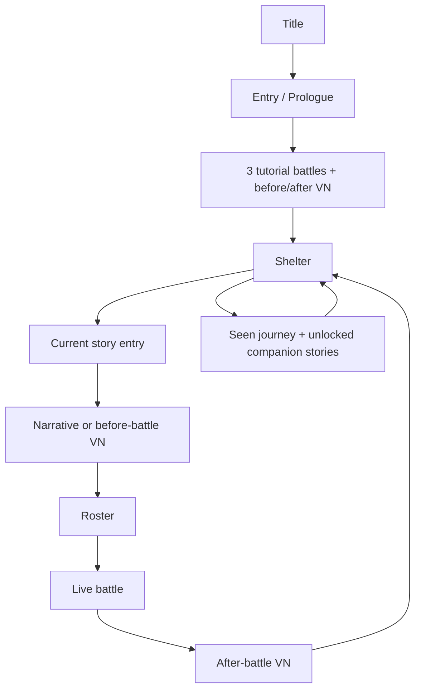
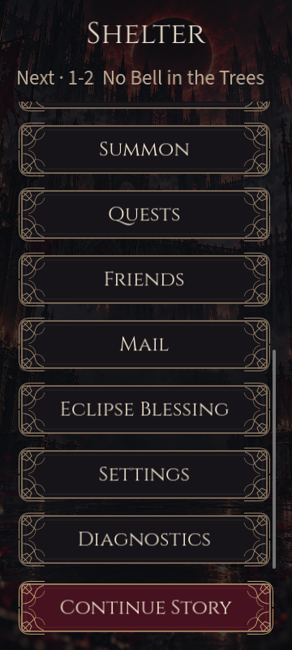
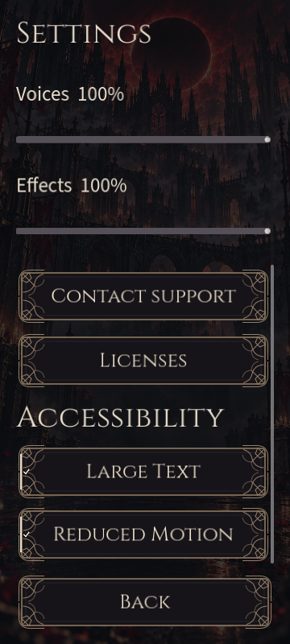

# Tam oyun tasarımı ve düzeltme raporu

İnceleme: 9 Ekim 2026; teslim: 10 Ekim 2026 · Unaware of My Demise · Part I: Unaware, I Fade

Bu çalışma kullanıcının tam oyun tasarımı, hata düzeltme ve açıcıyı onarma talebidir. Değişiklikler `game/` kaynak oyununa uygulandı. Mevcut `release/current` AAB, imzalar ve opening-base paketi değişmedi. Yeni AAB üretilmedi.

## Çalıştırma

GitHub Desktop → Fetch/Pull ile güncel main'i al → kökte **OYUNU_AC.cmd** dosyasını aç. Godot **4.7.2-stable** gerekir; bulunamazsa açıcı Windows'ta exe seçtirir ve sonraki açılış için hatırlar. Önce kaynakları import eder, sonra açılış + üç eğitim savaşı + yedi bölümün tamamını içeren **Full Story Review** sahnesini açar.

```bat
OYUNU_AC.cmd
```

Mevcut yerel ilerleme korunur. Yalnız baştan başlamak istediğinde:

```bat
OYUNU_AC.cmd -ResetReview
```

Tam inceleme profili `user://desktop_story_review`; eski opening review profili `desktop_review` altında ayrıdır. Google hesabı ve satın almaları kullanan asıl istemci `-Online`, eski açılış provası `-OpeningOnly` ile seçilir. Normal açılış tam hikâye modudur. Online hizmetler gerçek backend ve native bridge gerektirir.

Yerel savaşlar gerçek motorla oynanır. İnceleme seviyeleri önerilen seviye +10, mevcut 20 tavanıyla sınırlıdır. Bu destek tüm bölümleri ekonomik bekleme olmadan görmek içindir; online denge, gacha ve ödüller değişmedi.

## Kaybolan sahnelerin nedeni

Önceki açıcı `desktop_opening_review.tscn` seçiyordu. Backend'i yalnız açılışı gösterecek salt okunur snapshot veriyor; Shelter sonrası hikâye/savaş ilerlemesini reddediyordu. Yedi bölüm kaynakta duruyordu. Yeni `desktop_game_review.tscn` ve ayrı yerel backend mevcut StoryState kurallarıyla bütün sırayı yürütür.

İkinci hata, savaş öncesi/sonrası VN parçalarının hazırlanırken konum, müzik, sanat ve sahne yönlendirme alanlarını düşürmesiydi. `_half_scene` artık sahneyi derin kopyalar, yalnız diğer yarının replik alanlarını ayırır. Metadata sunuma ulaşır; kimlikler ve kanon sıra korunur.

## Oyun tasarımı

Oyunun ana vaadi, Mahmut'un korumaya çalıştığı insanın kendi kayboluşunu gizlemesi ve yol arkadaşlarının onu hatırlayarak borcu geciktirmesidir. Sunumun odağı Fadyme/Mahmut yakınlığı, çanlar ve silinen isimlerdir. İngilizce senaryo, dünya kuralları ve sürpriz sırası korunmuştur.

Döngü: Shelter'da sıradaki amacı gör → kısa VN → kadro → gerçek savaş → sonuç ve sonrası VN → yeni yol/kamp sahnesi. Kamp ve yol sahneleri beş savaşlık bölüm yapısının nefes aralarıdır. Story Records bu anları tekrar okunabilir kılar; ilk oynayış ilerlemesini tüketmez.



### Yedi bölümün ritmi

| Bölüm | Dramatik görev | Sunum kararı / üretim durumu |
| --- | --- | --- |
| 1 · Whispering Ash Forest | Mektup, ilk güven, çanın çağrısı; First Oath | Mektup CG'si ve orman plakası bağlandı. Merak/kararlılık ifadeleri; ilerideki hastalık işaretleri erken gösterilmez. |
| 2 · Saint Luthos | Kayıtlar, Yseldra ve Mahmut'un geçmişi | Duygu alias'ları ve diyalog sıra korunur. Katedralin final ortam resmi runtime'da yok; mevcut brief üretim kaynağıdır. |
| 3 · Oakhaven | Mizah ve kırılganlık; teslim emrinin somutlaşması | 3-3'ün belirli repliklerinde kanı gizleyen atkı varyantı; sürekli kan gösterimi yok. |
| 4 · Undercity | Tedavi umudunun borç ve tarif gerçeğine dönüşmesi | Yorgunluk/kırılganlık ifadeleri. Kalan süre mevcut özel konuşmalarda açılır; yeni bir spoiler sayacı eklenmedi. |
| 5 · Bridge of the Forsaken | İmzalanmış emrin sorumluluğu; görünür beyaz tutam | Beyaz tutam 5-4 sonrası başlar. Önceki sahnelerin replay'inde sonraki görünüm kullanılmaz. |
| 6 · Ashen Estate | İsimsiz portreler, annesinin yüzü, çan takvimi | Beyaz tutam devam eder; nihai siyah-altın eller erken kullanılmaz. Konağın final plakası bekliyor. |
| 7 · First Eclipse Altar | İsimlerin geri yazılması, Construct, itiraf, Cael | 7-5 sonrası siyah-altın el varyantı; itiraf ve Clockless CG'leri bağlandı. |

Görünüm seçimi güncel hesap cursor'undan değil, okunan sahnenin bağlamından yapılır. Geç oyun kaydıyla eski sahne açmak dönüşümleri geriye sızdırmaz. Companion sahneleri kendi `after_stage` bağlamını taşır. Üç hastalık varyantı ayrı çizimdir; her varyantın dokuz ayrı yüz ifadesi varmış gibi sunulmaz.

### Ekran tasarımı

**Shelter:** Continue Story alt kenarda sabit ve güçlü eylemdir. Sıradaki sahne üstte yazılıdır. Eldeki Mahmut/Fadyme portreleri yolculuğa yüz verir. İkincil menüler tek scroll içindedir; mevcut fontta ölçülen en uzun kelimeye göre bir/iki sütun seçilir. Büyük yazıda adların harf ortasından bölünmesi önlenir.

**VN:** Metadata, konum plakası, sahne CG'si ve duygu portresi korunur. Back/Next/Auto/Log mevcut işlevlerini taşır. Return to Shelter veya Return to Records görünürdür. Ana sahneden erken çıkmak cursor'u ilerletmez; replay ödül üretmez. İlerideki sahne veya kilitli hikâye metni buton verisine konmaz.

**Story Records:** Tamamlanan ana sahneler ve 76 companion parçası listelenir. Sahiplik, `after_stage` ve önceki parça kapıları uygulanır. Kilitli başlıklar sürpriz içermez; gereken işe alım ve aşama belirtilir. Bu ekran kısa kamp diyaloglarının arkasındaki ilişkileri keşfetmek için ayrı bir okuma alanıdır.

**Kadro / First Oath:** Mevcut seçim kuralları, gerçek portre ikonları. Görünür Back ve Android Back/Escape aynı hedefe döner. First Oath isteği beklerken tekrar onay ve geri çıkış engellenir; hata halinde seçim ve eylem geri açılır.

**Settings:** İçerik kayar, Back sabittir. Large Text %125 ve Reduced Motion mevcut AppShell tercih kaydına bağlandı. Ses slider'ları korunur. En alttaki erişilebilirlik düğmesine odaklanmak scroll'u da taşır.

**Geçiş ritmi:** Menü geçişleri 3.2 saniyeden yaklaşık 0.22 saniyeye indirildi; utility/faz geçişleri kısaltıldı. Yazılmış açılışın ve dramatik sahnelerin temposu ayrı kalır. Reduced Motion kaymayı ve sürekli karakter hareketini kaldırır; savaş saatini veya sonucu değiştirmez.

### Savaşın okunabilirliği

Hedefleme, beş kişilik kadro, misafir, boss fazı ve obje kuralları korunur. Oyuncu soldan sağa, düşman sağdan sola okunur. Can, odak ve beceri tepsisi canlı simülasyonu gösterir. Yerel seviye desteği online ürün dengesi kabulü değildir.

Fadyme'nin çizilmiş **4 idle / 8 walk** karesi SpriteFrames olarak bağlandı. Diğer saldırı/hit/victory durumları mevcut anahtar poz ve prosedürel hareket sistemidir; onlara yeni tam kare animasyon üretildi denmez. Altı VFX işlevi ayrıdır: Veilglass Thorn, Borrowed Hour, A Smile Kept, The Bell That Forgets, ally restore, ally cleanse. Beceri/can yenileme olayları görselleri tetikler; hasar hesabını shader yapmaz.

Aynı anda en fazla 12 yeni VFX; klip sonunda cleanup. Çizilmiş animasyon ve aktif VFX hızı ultimate yavaşlaması/hız seçimiyle birlikte değişir. Reduced Motion sabit shader şekli, gizli kıvılcım ve statik karakter pozudur. Kritik sonuç ve beceri bilgisi görünür kalır.

MIT GDQuest shader kodu ve CC0 Kenney dokuları kullanıldı. GDQuest'in NC sanatı runtime'a alınmadı. Kaynak/lisans/hash kayıtları üretim klasöründedir. MIT/CC0 notice kopyaları mevcut export preset’lerinin zaten içerdiği `game/data/legal/*` altında da tutulur; sealed paket yeniden üretilmedi. Fadyme için 29 provenance kaydı ve orman görselinin ayrı kaydı doğrulandı; kaynak master'lar korundu.

### Bütün karakterler

20 karakterin dört becerisi ve senaryo bağlantısı veri denetiminden geçti. Mevcut siluet/saç/palet farklılaştırma matrisi korunur. Başka karaktere Fadyme'nin yüzünü veya Mahmut'un gövdesini ödünç vermek final üretim çözümü sayılmaz.

| Karakter | Mekanik kimlik | Runtime sanat |
| --- | --- | --- |
| Mahmut | Ön hat / hasar · Stone | Portre + actor |
| Fadyme | Destek / hasar · Veil | Portre + actor; ek ifadeler ve idle/walk |
| Kera Voss | Simya / hasar · Ember | Veri/senaryo var; final portre/actor bekliyor |
| Brin Alder | Ön hat · Stone | Veri/senaryo var; final portre/actor bekliyor |
| Nixie Vale | Menzilli hasar · Gale | Veri/senaryo var; final portre/actor bekliyor |
| Sister Aveline | İyileştirme · Dawn | Veri/senaryo var; final portre/actor bekliyor |
| Sable Wren | Hedefli suikast · Veil | Veri/senaryo var; final portre/actor bekliyor |
| Tilda Fen | İyileştirme · Tide | Veri/senaryo var; final portre/actor bekliyor |
| Rikka Ember | Yakın hasar · Ember | Veri/senaryo var; final portre/actor bekliyor |
| Mirel Quill | Güçlendirme · Dawn | Veri/senaryo var; final portre/actor bekliyor |
| Odelia Pike | Okçu / zayıflatma · Tide | Veri/senaryo var; final portre/actor bekliyor |
| Pippa Bell | Bard / güçlendirme · Gale | Veri/senaryo var; final portre/actor bekliyor |
| Nara Vell | Ön hat / destek · Stone | Veri/senaryo var; final portre/actor bekliyor |
| Clem Marr | Zayıflatma · Veil | Veri/senaryo var; final portre/actor bekliyor |
| Vespera Wisp | Büyü hasarı · Veil | Veri/senaryo var; final portre/actor bekliyor |
| Hana Birch | Karşı saldırı · Stone | Veri/senaryo var; final portre/actor bekliyor |
| Thistle Roe | İyileştirme / destek · Gale | Veri/senaryo var; final portre/actor bekliyor |
| Iona Mist | İyileştirme · Tide | Veri/senaryo var; final portre/actor bekliyor |
| Jori Flint | Koruma · Ember | Veri/senaryo var; final portre/actor bekliyor |
| Marek Vane | Kontrol / güçlendirme · Gale | Veri/senaryo var; final portre/actor bekliyor |


Mahmut'un kimliği güvenilir ön hat ve saklanan geçmiş; Fadyme'ninki destek/hasar ile gizlenen tükeniştir. Jori'nin zincirlerdeki aile izi, Mirel'in silinen isimlerdeki eli ve Kera'nın tarifteki sorumluluğu finalin “tanık” temasına bağlanır. Companion okumaları kişisel borçları ana sıradan ayrı açar. Savaş kadrosu ile sinematikte yardıma gelen bütün arkadaşlar birbirine karıştırılmaz.

## Düzeltilen hatalar

| Bulgu | Düzeltme |
| --- | --- |
| Açıcı yalnız opening review açıyordu | Full Story Review varsayılanı, yerel backend ve kalıcı ilerleme. |
| CMD tam kaynak modu seçimini açıklamıyordu | Tam inceleme varsayılanını PowerShell yardımcısına bağlayan wrapper; Windows CRLF/eol korundu. |
| Godot import script hatasında exit 0 dönebiliyordu | stdout/stderr script/resource hatasını yakalama ve log konumu. |
| VN yarıları konum/müzik/sanat alanını düşürüyordu | Metadata'yı koruyan derin kopya. |
| Native Window Control offset'leri içeriği daraltıyordu | UiScreen/AppShell/review kökünde anchor ve offset birlikte sıfırlama. |
| Küçük ekranda menüler dışarı taşıyor / kelimeler bölünüyordu | Sabit Continue, tek scroll, font ölçüsüyle sütun seçimi. |
| Menüler Android Back/Escape ile dönemiyordu | Ortak geri yönlendirme ve roster/selector görünür dönüşü. |
| Platform Back, bekleyen pull/purchase/ödül isteğinin görünür Back engelini aşabiliyordu | Gacha, Blessing, Quests, Mailbox ve Friends busy guard; native 10/10 ek kontrol. |
| First Oath bekleyen istekte çift onay veya Back mümkündü | Busy guard ve görünür Back'in aynı guard'ı kullanması. |
| 76 companion parçasına runtime erişimi yoktu | Spoiler kapılı Story Records ve salt okunur replay. |
| Hazır ifadeler/CG/animasyon/VFX workbench'te kalıyordu | Üretim manifesti ve oyun olaylarına entegrasyon. |
| Reduced Motion karakter/cut-in'de eksikti | Statik poz, kapalı dönme/kayma ve sabit VFX varyantı. |
| Ultimate yavaşlamasında aktif VFX eski hızda kalıyordu | Ortak BattleField pace güncellemesi. |
| Yerel backend/GameFlow referans döngüsü | WeakRef; son tam testte çıkış leak uyarısı yok. |
| Yerel kayıt ve tekrar zafer akışı korunmuyordu | Geçici dosyadan atomik kayıt, bozuk dosyayı koruma, attempt resume, idempotent zafer. |
| Quote-clock testi yoğun yükte sabit 75 ms beklemeyle kararsızdı | İlk gerçek Timer timeout’unun gösterdiği repliği gözleyen test; oyunun 10 saniyelik saatine müdahale yok. |

## Doğrulama

- **GUT: 525/525 test**, 154.399 assertion, 71 script, 285.759 saniye.
- **Yerel hikâye: 51 sıra girdisi / 35 gerçek savaş / final tamamlandı.**
- **Native: 151/151 kontrol**, 58 framebuffer görüntüsü; 86 VN wrapper. Ek beş pending ekran için **10/10 native Back kontrolü**; toplam 161 kontrol.
- **İçerik: 29 JSON, 20 karakter, 80 beceri, 419 benzersiz ana replik kimliği, 76 companion parçası.**
- **Launcher: gerçek Godot ile import/source launch ve üç hata guard kontrolü geçti.**

[Kanıt dosyaları](../../narrative/15_Art_Workbench/full_game_review_v001/evidence/) · [Kabul özeti](../../narrative/15_Art_Workbench/full_game_review_v001/evidence/acceptance.json)





Canlı inceleme **Godot 4.7.2**, **Godot AI 4.3.0**, native pencere, Compatibility renderer ile yapıldı. Çerçeveler Godot framebuffer'ından kaydedildi. Bu makinenin renderer'ı Mesa llvmpipe; Android GPU performansı ölçülmedi. SDK bridge çalıştı; kullanıcının Windows Codex/Claude istemci keşfi bu oturumda tekrar ölçülmüş sayılmaz.

35 savaşın sonuna giden kabul scripted motor testidir. Native pencerede üç tutorial, ilk ana canlı savaş, 86 VN wrapper'ının yüklenmesi, menü dönüşleri, üç oran/%125 yazı ve normal/Reduced Motion VFX ayrıca doğrulandı. Bütün savaşlar telefonda elle oynanmış değildir.

PowerShell açıcı Linux PowerShell 7.5.4'te gerçek Godot ile import + headless source launch testinden geçti. Yanlış engine, çelişen mod ve exit 0 dönen script hatası reddedildi. CMD gerçek CRLF ve `%~dp0` göreli yol kullanır. Native Windows çift tıklama ve dosya seçici bu cloud makinede çalıştırılamadı.

GUT bazı mevcut fixture testlerinde frame sonunda silinecek düğümleri geçici orphan olarak raporlar; aynı bildirimler başlangıç baseline’ında da vardır. Son proses çıkışında ObjectDB/resource leak uyarısı veya script hatası yoktur. Native çekimlerden sonra cloud X ekranı sıfırlandı. 10 Ekim’de native editor/game ve SDK bağlantısı yeniden kuruldu; temiz cold açılış, framebuffer ve hata içermeyen game log tekrar doğrulandı. Editor’ın GUT sürüm kontrolü ağdan bilgi alamadı; bu ayrı editor uyarısı oyun script hatası değildir. [Cold açılış kanıtı](../../narrative/15_Art_Workbench/full_game_review_v001/evidence/cold-start.json).

BATCH-0005 Narrative migration denetimi eski 409 replik/27 dosya baseline'ına sabittir. Sonraki onaylı kanon 419 replik/29 dosyadır. Tarihsel manifest sahte geçiş için değiştirilmedi; bu eski validator bugünkü oyun kabul testi değildir. Güncel içerik denetimi mevcut bağlantıları doğrular.

## Gerçek üretim eksikleri

Bunlar kaybolmuş sahneler değildir; tamamlanmamış sanat/ses ve gerçek platform kabulüdür:

- Runtime portre **2/20**: Fadyme, Mahmut. Diğer 18'in son oyun portre seti yok. Canonical sheet varlığı tam ifade seti değildir.
- Actor art **4 kimlik**: Fadyme, Mahmut, Bellbound Dead, Hollow Pilgrim. Diğer hero/enemy çizimleri fallback sunumundadır.
- Battle ortamı **1/7**, orman; story ortamı da orman için bağlandı. Katedral, Oakhaven, Undercity, köprü, konak ve altarın son plakaları bekliyor.
- Üç yeni CG ve Fadyme'nin dört ek ifadesi bağlandı. Bütün konuşmacıların bütün duyguları için yeni çizim yapılmadı.
- Güncel Chirp3 HD audition paketi seçim referansıdır. Fadyme'nin **241 satırlık final ses paketi** tamamlanmadı. Eski Sulafat kayıtları güncel final diye geri getirilmedi; casting ve ücretli batch yapılmadı.
- Final müzik/SFX sanatsal kabulü tamamlanmadı. Null/Dummy ses çıkışlı makinede dinleme/miks kabulü verilemez.
- Google auth, satın alma, arkadaşlık ve hesap ekonomisi yerel review'da simüle edilmez. Bunlar gerçek Android bridge/backend üzerinden doğrulanmalıdır.
- Android touch density, düşük cihaz GPU/pil ölçümü ve native Windows açıcı testi gerçek cihazlarda bekliyor.

Ortak shader/animasyon/UX/Godot skill'leri uygulandı. Phantom Camera, demo karakter rig'i ve başka navigation framework'leri Control tabanlı oyuna yalnız kurulu oldukları için eklenmedi.

[Çalıştırma prompt'u](../coder/PLAY_LATEST_GAME_PROMPT_TR.md)
