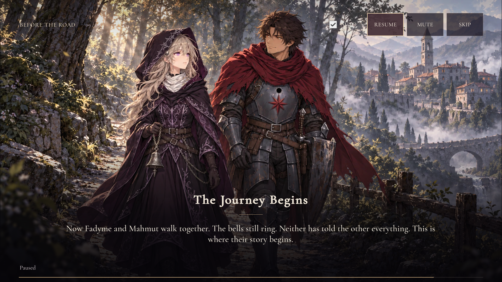

# Sol opening rebuild — 2026-10-26

The owner approved the first title image and the continuing visual direction. This delivery adds an original studio
emblem and nine individually generated prologue paintings, with raw PNGs, exact prompts, reference hashes and provenance
under `content/generated/openai/`. Earlier Gemini images supply identity references only.

## Native presentation

Startup, studio, title and prologue use dedicated controllers and editable UI Toolkit layouts. The cinematic stage uses
URP 2D SpriteRenderers, a native camera push, Light2D, a transparent emblem and bounded procedural dust. All credits and
captions are runtime text. The first-viewing skip restriction, checkpoint resume and existing account/entry contracts
remain intact. Muting keeps the audio subtitle clock running; pause freezes sound and movement. Auto-off waits at the
shot boundary. Reduced motion shows full captions with no camera push or particles.

The complete composition fits 16:9, 20:9 and 4:3 with cinematic bars where required. A paused resize updates the fit while
keeping narrative time frozen. A missing image presents explicit Retry and Continue Without It controls. Leaving the
screen restores the original camera, lighting and UI backgrounds; stale loads cannot recreate the stage.

## Paintings and in-engine captures

| Shot | Canonical hold | New asset | Unity capture |
| --- | ---: | --- | --- |
| Before the Road | 12 s | `sol_prologue_hours` | [01](../evidence/sol-opening-01.webp) |
| Names to Remember | 14 s | `sol_prologue_names` | [02](../evidence/sol-opening-02.webp) |
| Ordinary Days | 12 s | `sol_prologue_ordinary_days` | [03](../evidence/sol-opening-03.webp) |
| The Throne Wars | 12 s | `sol_prologue_throne_wars` | [04](../evidence/sol-opening-04.webp) |
| Six Years Ago | 16 s | `sol_prologue_crownfall` | [05](../evidence/sol-opening-05.webp) |
| What Remained | 16 s | `sol_prologue_roads` | [06](../evidence/sol-opening-06.webp) |
| A Name on the Road | 14 s | `sol_prologue_search` | [07](../evidence/sol-opening-07.webp) |
| Found Again | 12 s | `sol_prologue_reunion` | [08](../evidence/sol-opening-08.webp) |
| The Journey Begins | 12 s | `sol_prologue_beginning` | [09](../evidence/sol-opening-09.webp) |

[Studio](../evidence/sol-opening-studio.webp) · [20:9](../evidence/sol-opening-2400x1080.webp) ·
[4:3](../evidence/sol-opening-1600x1200.webp) · [Executed evidence](../evidence/sol-opening-2026-10-26.json)

## Verification and remaining work

The normal-speed nine-shot replay completed in 120.23 seconds. At most two plate sprites and 41 particles were observed
in this Editor run (configured particle cap: 64). All nine captures were visually inspected. EditMode: 102/102;
PlayMode audio tests: 3/3; headless logic: 101/101; reference compile: 11 assemblies, zero errors. `npm run verify` passed,
including 507 API cases and exact reproduction of 216 content files. Final project console: zero errors and warnings.

The ten new images remain integration candidates. The paintings are native 1672x941; the alpha emblem is native
1254x1254. No upscaling, final-2K acceptance or owner approval of these ten images is claimed. Whole-scene paintings and
camera/particle motion are implemented; independent bell, rope and actor animation remain a later asset pass.

Next: new story portraits and the three tutorial stages, then real battle presentation and the hub/system screens.
Physical Android graphics/lifecycle/provider acceptance and a signed release artifact remain required.
