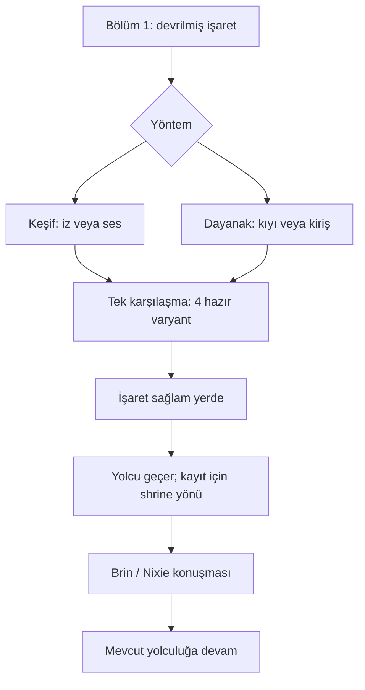

# Son Geçen İçin — bölümler ve akış

Açılış: ana hikâye `1-4` sonrası ve ilgili patch yayına alındığında. Runtime stage ID mapping’i henüz seçilmedi.

## Bölüm 1 — Devrilmiş İşaret

`lt_a1_sign → lt_a1_load → lt_a1_method`

İşaret ve yumuşak zemin okunur. Direği sürekli omuzda tutmak yerine önce hazırlık yapılır. Keşif veya dayanak seçilir.

[Tam bölüm scripti](scripts/BOLUM_01.md).

## Bölüm 2 — Yolu Hazırlamak

`lt_a2_scout_1..3 / lt_a2_brace_1..3`

Keşif: yaprak/iz/ses, iki gözlem odağı, işaretin yolcunun baktığı yerden kontrolü. Dayanak: sağlam kıyı/kuru kiriş, iki tutunma odağı, karşılıklı çağrı provası. Her tur üç sahne oynar.

[Tam bölüm scripti](scripts/BOLUM_02.md).

## Bölüm 3 — Açık Geçit

`lt_a3_watch → lt_b01 → lt_a3_clear`

Yöntem alt seçimi dört hazır 5v5 tasarımından birini seçer. Yolcu savaşta hedef veya altıncı müttefik değildir. Standart zaferden sonra işaret sağlam yere konur.

[Tam bölüm scripti](scripts/BOLUM_03.md).

## Bölüm 4 — Son Geçen

`lt_a4_traveler → lt_a4_pause → lt_a4_company → lt_a4_end`

Adsız yolcu geçer. Kayıt için shrine keeper’a yönlendirilir. Brin veya Nixie ile kısa konuşma; ekip mevcut ana yoluna devam eder.

[Tam bölüm scripti](scripts/BOLUM_04.md).

## Seçimler

| State alanı | Değerler | Sonuç |
|---|---|---|
| `method` | `scout / brace` | Nixie’nin keşfi veya Brin’in dayanağı; üçer sahnelik iki farklı yol. |
| `plan` | `scout_tracks / scout_sound veya brace_bank / brace_beam` | Sadece seçilen yöntemin iki alt seçeneği geçerlidir. Dört encounter tasarımından biri. |
| `focus` | `brin / nixie` | Altı satırlık Brin veya Nixie kapanışı; aynı ortak sonuç. |

Toplam 8 geçerli ilk tur yolu. Tek bir doğru son yok; bütün yollar standart zaferle aynı ana sonuca gider.

## Kayıt ve geri dönüş

Seçim, seçenek metni ve görünen sonuç önizlemesiyle sunulur. Onaylanan seçim hesaba/event revision’a yazılır; sonraki sahnede değiştirilemez. Sahne devamı VM cursor ile, event devamı active_node_id ile korunur. Savaş kaybı aynı node’dan tekrar eder; karakter ölümü gibi kalıcı hikâye cezası yok. Sahne sonu checkpoint restore yerel olarak doğrulandı; gerçek UI’da seçim öncesi/ortası resume ayrıca yapılmalı.

## Replay sınırı

method_replays seçilmeyen üç sahnelik yöntemi ayrı açar ve lt_a3_watch öncesinde biter. Yöntem içindeki plan seçimi replay oturumuna yazılır. conversation_replays iki kapanışı açar; scene_replays tüm sahneleri kapsar. Genel state_keys Cartesian çarpımı 16 üretir ama sekizi geçersiz yöntem/plan eşleşmesidir: validation_cases yalnız sekiz anlamlı kombinasyonu içerir.

Replay ilk tur kararlarını, completion ve gelecekte bağlanacak claim kayıtlarını değiştirmez. Ödül politikası belirlenmedi. Savaş tekrarının runtime bağlaması ayrıca uygulanacak.

## Hikâye yerleşimi

Bu paket sıfır kaynak sahne kopyası içerir; tamamen yeni yaratıcı yan görevdir. Part I Story Bible, dünya kuralları, spoiler unlock policy ve Brin/Nixie profilleri referans alındı. 1-4 sonrasındaki mevcut yol gününe yerleşir; yeni gün veya Part I’in üç haftalık zamanına uzatma eklenmez.

Brin’in babası ve Two Roofs companion olayı yeniden anlatılmaz. Nixie’nin gerçek soyu, false-map veya home/registry sırları çözülmez. Yolcu kayıp kraliyet tanığı, gizli düşman veya önemli yeni karakter yapılmaz. Shrine kaydı gereksiz ilan edilmez; ekip yol temizlemektedir, resmi kayıt tutmamaktadır. Brin’in 2-1’deki ayrılışı korunur.
