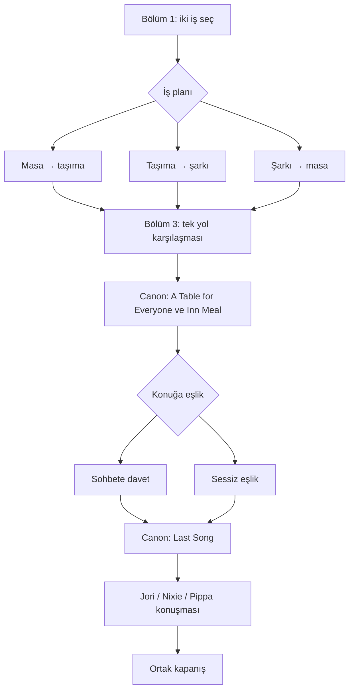

# Bir Tabak, Bir İsim — bölümler ve akış

Açılış: ana hikâye `3-5` sonrası ve ilgili patch yayına alındığında. Runtime stage ID mapping’i henüz seçilmedi.

## Bölüm 1 — Meydanın Henüz Boşken Hali

`od_a1_square → od_a1_plan`

Jori, Nixie ve Pippa’nın ihtiyaçları görülür. Üç plandan biri seçilir; her plan iki işi sırayla açar. Seçilmeyen iş NPC yardımıyla biter.

[Tam bölüm scripti](scripts/BOLUM_01.md).

## Bölüm 2 — İki Küçük İş

`od_job_wood_1..3 / od_job_road_1..3 / od_job_song_1..3`

Masa: sağlamlaştırma, onarılmış sandalye, servis boşluğu. Taşıma: düz güzergâh, yükü paylaşma, bir sonraki yardımcıya işi devretme. Şarkı: isme yer açma, hikâyesini anlatmadan katılma, birlikte prova. Her tur altı sahne oynar.

[Tam bölüm scripti](scripts/BOLUM_02.md).

## Bölüm 3 — Sofraya Giden Yol

`od_a3_road → od_b01 → od_a3_clear → event_harvest_inn_meal_1 → od_a3_after_soup`

Son yük içeride güvende kalır. Tek 5v5 karşılaşmanın varyantını iş planı belirler. Zafer ardından kaynak A Table for Everyone ve Kera’nın çorbasına küçük bir devam oynar.

[Tam bölüm scripti](scripts/BOLUM_03.md).

## Bölüm 4 — Bir Kâse İçin

`event_harvest_inn_meal_2 → od_a4_gap → od_a4_join_echo / od_a4_quiet_echo`

Kaynak Inn Meal korunur. Bir konuğa sohbete katılma daveti veya sakin eşlik seçilir. Konuk her iki dalda şarkıya katılıp katılmamaya kendi karar verir.

[Tam bölüm scripti](scripts/BOLUM_04.md).

## Bölüm 5 — Son Şarkı

`event_harvest_inn_meal_3 → od_a5_after_song → od_a5_company → od_a5_end`

Kaynak Last Song’dan sonra Jori, Nixie veya Pippa ile kısa konuşma. Üçü aynı ortak kapanışa gider; meydan ertesi gün de kullanılabilecek halde bırakılır.

[Tam bölüm scripti](scripts/BOLUM_05.md).

## Seçimler

| State alanı | Değerler | Sonuç |
|---|---|---|
| `plan` | `wood_road / road_song / song_wood` | Masa→taşıma / taşıma→şarkı / şarkı→masa. Altı sahne ve üç farklı encounter tasarımından biri. |
| `welcome` | `join / quiet` | Davet veya sessiz eşlik; seçime özgü beş repliklik callback sahnesi. |
| `focus` | `jori / nixie / pippa` | Seçilen karaktere özgü altı satırlık son konuşma. |

Toplam 18 geçerli ilk tur yolu. Tek bir doğru son yok; bütün yollar standart zaferle aynı ana sonuca gider.

## Kayıt ve geri dönüş

Seçim, seçenek metni ve görünen sonuç önizlemesiyle sunulur. Onaylanan seçim hesaba/event revision’a yazılır; sonraki sahnede değiştirilemez. Sahne devamı VM cursor ile, event devamı active_node_id ile korunur. Savaş kaybı aynı node’dan tekrar eder; karakter ölümü gibi kalıcı hikâye cezası yok. Sahne sonu checkpoint restore yerel olarak doğrulandı; gerçek UI’da seçim öncesi/ortası resume ayrıca yapılmalı.

## Replay sınırı

activity_replays üç işi ayrı açar. stop_after_node, ilgili üçüncü sahneden sonra ana graph geçişi değerlendirilmeden replay’i bitirir; bu sınır olmadan seçilmeyen işi oynatmak yanlışlıkla ikinci işe veya ortak şölen sahnesine geçebilir. conversation_replays üç son konuşmayı; scene_replays tüm sahneleri kapsar.

Replay ilk tur kararlarını, completion ve gelecekte bağlanacak claim kayıtlarını değiştirmez. Ödül politikası belirlenmedi. Savaş tekrarının runtime bağlaması ayrıca uygulanacak.

## Hikâye yerleşimi

Kaynak event_harvest_inn_meal içindeki üç sahne ve 14 satır birebir korunur. Kaynağın sofra/isim kuralı değiştirilmez; hikâyesini herkese anlatma zorunluluğu eklenmez. Nixie’nin kısa süreli parlaması kaynak mizahıdır, stat buff’ı değildir. Fadyme’nin çanı yüksek sesli meydanda kaybetmesi iç düşünce/mecazdır; çan veya saat borcu gerçekte iptal olmaz.

Pippa’nın bell charm kökeni, Silent Bell sırrı, Nixie’nin soyu, Jori’nin gizli işleri ve Fadyme’nin kraliyet adı/hastalığının çözümü açılmaz. Canon Inn Meal’deki Fadyme/Mahmut varlığı korunur. Oyuncunun yapmadığı iş yüzünden kimse aç kalmaz; başarı/moral puanı yok.
