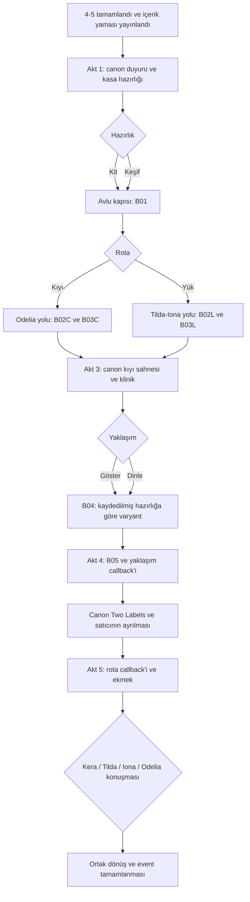

# İki Etiket — bölümler, akış ve seçimler

## Açılma ve anlatı yerleşimi

- Yama yayınlanmış olmalı ve sunucu ana hikâyedeki **stage 4-5’in tamamlandığını** doğrulamalı. Sadece chapter ekranını açmak veya yerel progress flag’i yeterli değil.
- 4-5’ten önce kart event adını/karakterini/lonca çatışmasını göstermez; genel kilitli içerik sunumu kullanılabilir. İçerik bildirimleri de aynı kapıyı izler.
- Event’i daha ileri bir bölümde açan oyuncu, 4-5 sonrasına yerleştirilmiş bir yan olayı oynar. Ana hikâye zaman çizgisi geri alınmaz; Fadyme/Mahmut ana rota dışındaki bu sevkiyata zorla eklenmez.
- Zorunlu oynama veya ana hikâyeye devam etme şartı değildir. Karakter sahipliği, satın alma ve reklam koşulu yok.
- Event’in gerçek dünya takvimi henüz yok. Aktları ayrı ayrı takvim gününe bağlamıyoruz; açılınca hikâye sırayla oynanabilir. Yeni üç hafta, kayıp saat ya da zaman sıçraması eklenmiyor.

## Beş bölüm

| Akt | Başlangıç sorusu | Gelişme | Bölümün kapanışı |
|---|---|---|---|
| 1 — Arşivin Kapısı | Dört kişi ücretsiz tedavi sevkiyatını nasıl hazırlayacak? | Duyuru, kasaların hazırlanması, ilk hazırlık seçimi, avlu kapısı savaşı ve rota seçimi | Ekip iki yolun da aynı teslimata çıkacağını bilerek yola girer |
| 2 — İki Yol | Bu yolu kim biliyor; nasıl ilerlemeliyiz? | Kıyıda Odelia’nın aşinalığı ve arka sıra tehditleri; yük yolunda Tilda–Iona’nın işi ve ön baskı | Kasalar aynı limana güvenle ulaşır |
| 3 — Temiz Masa | İnsanlar ücretsiz ilaca neden şüpheyle bakıyor? | Mevcut kıyı sahnesi, fırın yan odası, soru/demonstrasyon tercihi, güvenli sınır savaşı | İnsanlara borç/kan örneği/onay baskısı olmadan bakım sunulur |
| 4 — İki Etiket | Son teslimattan sonra satıcının iddiasına nasıl cevap verilir? | Son yol savaşı, sosyal seçim callback’i, mevcut satıcı sahnesi ve sonrası | Satıcı ayrılır; insanlar Kera’nın açıklanmış, ücretsiz tedavisini seçer |
| 5 — Boş Kasalar | İş bittiğinde ekip birbirinde ne fark etti? | Son hastanın soruları, rota callback’i, karşılıksız ekmek, bir ekip konuşması ve dönüş | Aynı ortak son; hiçbir gizem çözülmez, hiçbir yeni zorunlu görev başlamaz |

## Akış diyagramı

## Ayrıntılı oynatma sırası

### Akt 1 — Arşivin Kapısı

`event_guild_salt_fever_1` → `tl_a1_crates` → `tl_a1_preparation` → `tl_a1_gate` → **B01** → `tl_a1_after_gate` → `tl_a1_fork`.

Hazırlık, o sahnede yalnız ilgili kısa konuşmayı açar. Asıl taktik karşılığı Akt 3’te B04 varyantını seçmesidir. Rota ayrı karar; kit seçmek kıyıyı, keşif seçmek yük yolunu kapatmaz. Oyuncu ayrı bir kişi olarak canon’a eklenmez; seçenekler ekibin aldığı kararları yönlendirir.

### Akt 2 — Kıyı patikası

`tl_a2_coast_wall` → **B02C** → `tl_a2_coast_steps` → `tl_a2_coast_turn` → **B03C** → `tl_a2_coast_arrival`.

Odelia’nın kapalı fırın penceresi ve eski basamakları fark ettiği konuşma yalnız bu yolda bulunur. Gizli eşya arama veya kardeşinin akıbetine ilişkin yeni kanıt yok. Kıyı savaşları arka sıradaki baskının ön sıradan farklı olduğunu gösterir; başlı başına daha zor rota sayılmaz.

### Akt 2 — Eski yük yolu

`tl_a2_load_sheds` → **B02L** → `tl_a2_load_cloth` → `tl_a2_load_cart` → **B03L** → `tl_a2_load_arrival`.

Kısa yağmur molasında Tilda ile Iona bakımın tedaviyi getirmekten daha geniş olduğunu konuşur. Yaşayan araba sürücüsü güvenli siperin arkasındadır; escort HP/timer sistemi yok. Yük yolu savaşları ön sırayı istikrarlı tutmaya odaklanır.

### Akt 3 — Temiz Masa

İki yol → `event_guild_salt_fever_2` → `tl_a3_bakery` → `tl_a3_questions` → `tl_a3_boundary` → **B04** → `tl_a3_after_boundary`.

`show` tercihinde mühürlü malzemeler gösterilir ve açıklanır; gerçek alchemy tarifi/ilaç dozu yazılmaz. `listen` tercihinde insanın neden çekindiği dinlenir. Her ikisinde de karar ve onay hastadadır. B04 bağımsız olarak `prep` alanına göre kit/keşif varyantını seçer; sosyal yaklaşım savaş kolaylığı satın almaz.

### Akt 4 — İki Etiket

`tl_a4_last_lane` → **B05** → `tl_a4_delivery_done` → `tl_a4_echo_show` **veya** `tl_a4_echo_listen` → `event_guild_salt_fever_3` → `tl_a4_after_agent`.

Son savaş satıcıdan önceki yol tehdididir; satıcının bu düşmanları yönettiği iddia edilmez. Mevcut üç replikli final sahnesi kesilmeden oynar. Köylülerin tercihi bütün dallarda korunur. Sonrasında fırıncı eski satış kâğıdını kendi duvarından kaldırır; bu küçük jest yeni bir siyasi zafer ilanı değildir.

### Akt 5 — Boş Kasalar

`tl_a5_quiet` → `tl_a5_coast_memory` **veya** `tl_a5_load_memory` → `tl_a5_bread` → `tl_a5_company` → `tl_a5_end` → `tl_complete`.

Son konuşmadaki dört seçenek ayrı 8 satırlık mini sahnelerdir; yalnız biri ilk turda oynar. Bu seçim ana sonu ve başka görevleri değiştirmez. Ekmek öykü prop’udur; envanter ödülü tanımlamaz.

## Seçim sonuçlarının sözleşmesi

| Alan | Değerler | Kalıcı ilk tur etkisi | Replay |
|---|---|---|---|
| `prep` | `clean`, `scout` | Akt 1 konuşması + B04 encounter varyantı | İlk turu değiştirmeyen ayrı oturum |
| `route` | `coast`, `load` | Akt 2’nin dört sahnesi/iki savaşı + Akt 5 rota callback’i | Diğer rota doğrudan açılabilir |
| `approach` | `show`, `listen` | Akt 3 konuşma dalı + Akt 4 geri dönüş sahnesi | İki dal ayrıca izlenebilir |
| `focus` | `kera`, `tilda`, `iona`, `odelia` | Akt 5’te bir ekip konuşması | Diğer üç konuşma ayrı izlenebilir |

“Doğru” rota ve gizli güven/ahlak puanı yok. Bir tercih yapıldığı için bir köy tedavisiz veya bir NPC ölü kalmaz. Ödüller belirsiz olduğu için dal/ustalık/replay ödül sonuçları bu tasarımda seçilmez.

## Kaybetme, kesinti ve tekrar

- Savaş düğümünün başarılı çıkışı yalnız sunucunun doğruladığı zaferle açılır. Mağlubiyet, düğümde kalır; yeni bir kaybetme canon’u yok.
- Savaş için tekrar/enerji/ödül politikası sonradan bağlanacak. Yeniden deneme event state’ini ve önceki tercihleri silmez.
- Sahne sonunda açık checkpoint vardır. Gerçek uygulama, replik sonrası güvenli StorySave’i de saklayabilir; seçim beklerken pending-choice save hatası yaratmamalı, seçim öncesi kayıtla aynı soruyu yeniden göstermeli.
- Skip diyalog tüketir; bir rota veya henüz yapılmamış savaş zaferini üretmez. Dört karar için seçim bekler.
- İkinci rotanın kısa replay’i Akt 2 başından başlar, limana varınca replay menüsüne döner. İlk tur event progress’ini geri almaz.
- Ses kesilirse metin devam edebilir. Voice zorunlu mekanik kapı değildir. Asset bulunamaması ayrı teknik hatadır; boş sahnede ilerleme yazılmaz.

## Canon koruması

Üç kaynak sahnesinin `scene_id`, başlık, `location_id`, direction, tüm line ID/konuşmacı/text/emotion/voice track kayıtları [snapshot](authoring/canon_source_snapshot.json) içinde birebir korunur. Kaynak sıra: duyuru → kıyı → satıcı. Özgün yeni NPC’ler fırıncı, hasta ve araba sürücüsü rolünde event kapsamlı kimliklerdir; başka canon NPC’nin yerine geçirilmezler.

Ana hikâyeye dönüş, sonu değiştirme veya ana karakterlerin mevcut ayrılış/geliş düzenini değiştirme yok. Karakter sahipliği ile VN fiziksel mevcudiyeti ayrıdır; oyuncunun savaş kadrosu bir seyahat canon’u oluşturmaz.
