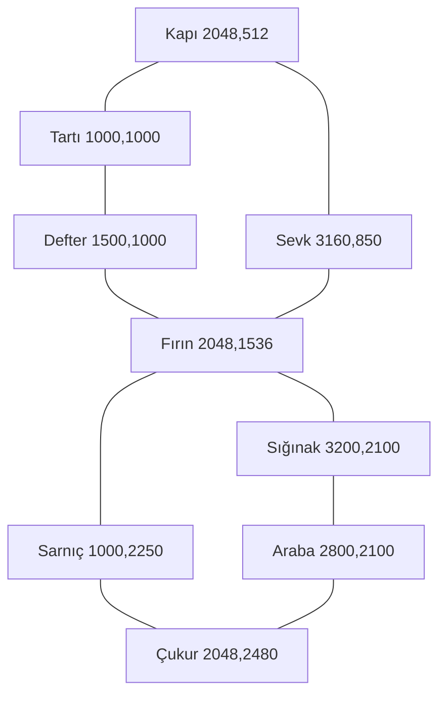

# Tek arena ve karşılaşma yönetişimi

Tüm görevler `ac_charcoal_yard` kullanır. Yeniden yüklenen ayrı on harita yoktur. Görselde sönmüş fırın, kayıtlı tartı, sığınak, boş araba, su birikimi ve çukur yerleri her bölümde aynıdır; aktif yol ve tehlike çizgileri değişir.

Şema bağlantıları yol niyetini gösterir; kollizyon duvarları değildir. İlk dilimde sadece dış sınır katıdır. Dekorun içinden geçildiği gizlenmez; son kollizyon blokları ayrı nav/kaçış QA'sından sonra açılır. Tam arena 4096×3072, oynanabilir dikdörtgen x/y 256'dan başlar ve 3584×2560'dır. Oyuncu yarıçapı 16; tüm hedefler içeridedir. Kamera 1024×576 dünya birimi gösterir; 1920×1080 HUD bunun üzerine ölçeklenir. Joystick kamera yakınlığını değiştirmez. Lider hızı 240 birim/sn; tüm avluyu düz geçmek yaklaşık 15 sn'dir, engel ve savaş bunu uzatır.

## Spawn ve güvenli kaçış

Spawn portalları önce şablondan önerilir, sonra kamera ve oyuncu mesafeleri denetlenir. Kameranın 96 birim ötesi tercih edilir; liderden 220 ve aktif hedefin merkezinden 160 birimden yakın yeni düşman konmaz. Kenarda geçerli kamera dışı yer bulunamıyorsa uzaktaki görünen portal 1,2 sn uyarıyla açılır. 16 denemede yer bulunamazsa batch atlanır; biriken görünmez spawn borcu yoktur. Mevcut düşman oyuncuyu takip ederek objektife gelebilir; spawn exclusion güvenli bölge anlamına gelmez.

Horde cap 160 bütün regular, elit ve boss'ları kapsar. Bir anda bütün halkayı kapatan mob çemberi yoktur. Paralel hat aralığı 224, asgari kaçış açıklığı 192 birimdir. Tehlikelerin birleşimi 96 yarıçaplı ulaşılabilir güvenli disk ve açıklık bırakmalıdır. Güvenli şekil testi geçmezse hazard 30 tick ertelenir, üç denemede hâlâ güvenli değilse atlanır. Bu bir tasarım sözleşmesidir; matematik ve Android oynayış testleri yapılmadan güvenli olduğunu varsaymak yasaktır.

## Dalgaların ayrıntısı

Her bölümün 6 fazı `authoring/chapters.json` içinde ayrı kayıttır: başlangıç/bitiş tick'i, 180 tick batch aralığı, miktar, ağırlıklı family havuzu, portal deseni, ambient hazard ve aktif objektif aşaması. İlk saat tick 0, son normal faz 10800'de biter. Batch faz başlangıcında ve +180 aralıklarla çıkar; end_tick dahil değildir. Düşman ailelerinin bağımsız katsayıları bölüm taban çarpanı ve kademe çarpanıyla çarpılır. Boss ayrı tabloda kendi HP/hasarını kullanır. Her 30. başarılı normal spawn aynı aileden elit olur; en fazla dört elit. Portal yerleşimi reddedilen spawn elit sayacı artırmaz.

Chapter 7 araba takip çizgisi sırasıyla üç durağa gider. Lider 180 birim yakınken 72 birim/sn yürür; durakta 30 tick bekler. Arabaya HP konmaz, düşman onu vurmaz; oyuncunun sürekli ölmeden yakın kalabilmesi asıl baskıdır. Lider uzaklaşınca araba durur. Chapter 10'daki `front_arc` referansı ilk uyarıda liderin son sıfır olmayan hareket yönüdür; başlamadıysa kuzey. Chapter 7'de cart_heading kullanılır. Bu heading spawn sırasında sabitlenir; her frame dönüp kaçışı kovalamaz.

## Boss okuma dili

10 boss, canon'daki beş family'nin yeni avlu rolüdür. Rusk veya ana hikâye boss'u tekrar öldürülmez. Her profile ad, family, HP, hız, phase eşiği, tam atak sırası ve karşı oyun yazılmıştır. Atak geometrileri `bosses.json/attack_profiles` içindedir. Genelde %50'de sıra değişir; son boss %66 ve %33'te hat → mürekkep → fırın dili kullanır. Faz değişimi HP doldurmaz. Boss daima vurulabilir; belirli elemental gacha karakteri zorunlu değildir. Phase değişiminde 30 tick pause ve görünür UI açıklaması, ardından yeni uyarı gelir.

Ambient hazard boss sırasında kapanır. Boss saldırıları kendi warning/collider şekillerini üretir. Boss ile çakışan düşman projektilleri veya eski ink diskleri geçişte temizlenir. Warning en az 45 tick, fırın cross 75 tick; damage rütbe arttıkça artsa da uyarı hiç hızlandırılmaz. Hasarsız rest_window açıkça hasarsızdır. Aktif alan her tick yeniden vurmaz: global iframe ve cast/hazard kaynak kimliği beraber denetlenir.

## 01 — Açık Kapı

Tebeşir işaretlerini topla; geçit boyunca geri dön. İlk koşu hareket ve otomatik saldırıyı öğretir.

Oyuncu briefing: The yard was meant to keep the carts moving. Someone shut its gate from the inside.

| Faz | Zaman/sn | Batch | Desen | Ambient |
|---|---|---|---|---|
| 1 | 0–60 | 3 / 6 sn | approach | yok |
| 2 | 60–120 | 3 / 6 sn | fan | yok |
| 3 | 120–180 | 4 / 6 sn | approach | yok |
| 4 | 180–240 | 4 / 6 sn | fan | yok |
| 5 | 240–300 | 5 / 6 sn | approach | yok |
| 6 | 300–360 | 5 / 6 sn | fan | yok |

Hedefler sıra ile: `[[2048, 512], [1000, 1000], [3160, 850]]`. Yeni aşamalar 0/120/240 sn'de açılır; 360 sn'ye kadar üçünün bitmesi gerekir. Boss: `charcoal_carrier`. Eşlik eden aileler: hollow_pilgrim, ash_wolf.

## 02 — İsimsiz Tartı

Üç tartı levhasını farklı yaklaşım yönlerinden topla; paralel düşman hatlarının arasından geç.

Oyuncu briefing: The weighbridge counted every load and no one who carried it.

| Faz | Zaman/sn | Batch | Desen | Ambient |
|---|---|---|---|---|
| 1 | 0–60 | 4 / 6 sn | parallel | yok |
| 2 | 60–120 | 4 / 6 sn | approach | yok |
| 3 | 120–180 | 5 / 6 sn | parallel | yok |
| 4 | 180–240 | 5 / 6 sn | fan | yok |
| 5 | 240–300 | 6 / 6 sn | parallel | yok |
| 6 | 300–360 | 6 / 6 sn | fan | yok |

Hedefler sıra ile: `[[1000, 1000], [1500, 1000], [2048, 512]]`. Yeni aşamalar 0/120/240 sn'de açılır; 360 sn'ye kadar üçünün bitmesi gerekir. Boss: `scale_minder`. Eşlik eden aileler: hollow_pilgrim, orchard_ghoul.

## 03 — Değiştirilen Yol

Eski sevk etiketlerini güney-doğu-kuzey rotasında al; kurt kıskacında yön değiştir.

Oyuncu briefing: The dispatch tags sent the last carts back into the yard.

| Faz | Zaman/sn | Batch | Desen | Ambient |
|---|---|---|---|---|
| 1 | 0–60 | 4 / 6 sn | pincer | yok |
| 2 | 60–120 | 4 / 6 sn | fan | yok |
| 3 | 120–180 | 5 / 6 sn | pincer | yok |
| 4 | 180–240 | 5 / 6 sn | approach | yok |
| 5 | 240–300 | 6 / 6 sn | pincer | yok |
| 6 | 300–360 | 6 / 6 sn | fan | yok |

Hedefler sıra ile: `[[3160, 850], [3200, 2100], [2048, 512]]`. Yeni aşamalar 0/120/240 sn'de açılır; 360 sn'ye kadar üçünün bitmesi gerekir. Boss: `road_hound`. Eşlik eden aileler: ash_wolf, hollow_pilgrim.

## 04 — Geçici Kuru Yer

Çevredeki üç sığınak mandalını aç; merkez etrafında dönen tehdide tek yönde bağımlı kalma.

Oyuncu briefing: The shelter was locked to protect the stock from the rain.

| Faz | Zaman/sn | Batch | Desen | Ambient |
|---|---|---|---|---|
| 1 | 0–60 | 5 / 6 sn | orbit | shutter |
| 2 | 60–120 | 5 / 6 sn | approach | shutter |
| 3 | 120–180 | 6 / 6 sn | orbit | shutter |
| 4 | 180–240 | 6 / 6 sn | fan | shutter |
| 5 | 240–300 | 7 / 6 sn | orbit | shutter |
| 6 | 300–360 | 7 / 6 sn | approach | shutter |

Hedefler sıra ile: `[[3200, 2100], [2800, 2100], [3160, 850]]`. Yeni aşamalar 0/120/240 sn'de açılır; 360 sn'ye kadar üçünün bitmesi gerekir. Boss: `shelter_warden`. Eşlik eden aileler: orchard_ghoul, hollow_cleric.

## 05 — Kara Suyun Altı

Üç sabit tahliye kolunu sırayla çevir; su şeritlerinin değişen güvenli tarafını kullan.

Oyuncu briefing: Runoff has reached the old name boards.

| Faz | Zaman/sn | Batch | Desen | Ambient |
|---|---|---|---|---|
| 1 | 0–60 | 5 / 6 sn | approach | water |
| 2 | 60–120 | 5 / 6 sn | parallel | water |
| 3 | 120–180 | 6 / 6 sn | fan | water |
| 4 | 180–240 | 6 / 6 sn | parallel | water |
| 5 | 240–300 | 7 / 6 sn | approach | water |
| 6 | 300–360 | 7 / 6 sn | fan | water |

Hedefler sıra ile: `[[1000, 2250], [1000, 1000], [2048, 2480]]`. Yeni aşamalar 0/120/240 sn'de açılır; 360 sn'ye kadar üçünün bitmesi gerekir. Boss: `sluice_turner`. Eşlik eden aileler: hollow_pilgrim, inkbound_dead.

## 06 — Boş Kenar

Üç ayrı defter yaprağını al; hareket izi bırakan mürekkep yüzünden aynı yolu hemen tekrar kullanma.

Oyuncu briefing: The clerk kept a second book beneath the scale house.

| Faz | Zaman/sn | Batch | Desen | Ambient |
|---|---|---|---|---|
| 1 | 0–60 | 6 / 6 sn | fan | ink |
| 2 | 60–120 | 6 / 6 sn | approach | ink |
| 3 | 120–180 | 7 / 6 sn | pincer | ink |
| 4 | 180–240 | 7 / 6 sn | fan | ink |
| 5 | 240–300 | 8 / 6 sn | pincer | ink |
| 6 | 300–360 | 8 / 6 sn | approach | ink |

Hedefler sıra ile: `[[1500, 1000], [3160, 850], [1000, 1000]]`. Yeni aşamalar 0/120/240 sn'de açılır; 360 sn'ye kadar üçünün bitmesi gerekir. Boss: `ledger_clerk`. Eşlik eden aileler: inkbound_dead, hollow_cleric.

## 07 — Boş Arabayı Döndürmek

Bir araba üç durakta oyuncu yakındayken ilerler; temas menzilinde beklemek yerine önden koridor aç.

Oyuncu briefing: The burial cart was left under the shelter instead of taken to the village.

| Faz | Zaman/sn | Batch | Desen | Ambient |
|---|---|---|---|---|
| 1 | 0–60 | 6 / 6 sn | front_arc | yok |
| 2 | 60–120 | 6 / 6 sn | rear_arc | yok |
| 3 | 120–180 | 7 / 6 sn | front_arc | yok |
| 4 | 180–240 | 7 / 6 sn | pincer | yok |
| 5 | 240–300 | 8 / 6 sn | front_arc | yok |
| 6 | 300–360 | 8 / 6 sn | rear_arc | yok |

Hedefler sıra ile: `[[2800, 2100], [3200, 2100], [2048, 512]]`. Yeni aşamalar 0/120/240 sn'de açılır; 360 sn'ye kadar üçünün bitmesi gerekir. Boss: `cart_hauler`. Eşlik eden aileler: hollow_pilgrim, orchard_ghoul.

## 08 — Çukurun Sakladığı

Açık çukur kenarındaki üç taşı işaretle; kül fırtınalarının önceden görünen yönüne göre yol değiştir.

Oyuncu briefing: The pit must be marked before another load is tipped into it.

| Faz | Zaman/sn | Batch | Desen | Ambient |
|---|---|---|---|---|
| 1 | 0–60 | 7 / 6 sn | pincer | gust |
| 2 | 60–120 | 7 / 6 sn | approach | gust |
| 3 | 120–180 | 8 / 6 sn | parallel | gust |
| 4 | 180–240 | 8 / 6 sn | pincer | gust |
| 5 | 240–300 | 9 / 6 sn | fan | gust |
| 6 | 300–360 | 9 / 6 sn | parallel | gust |

Hedefler sıra ile: `[[2048, 2480], [1000, 2250], [3200, 2100]]`. Yeni aşamalar 0/120/240 sn'de açılır; 360 sn'ye kadar üçünün bitmesi gerekir. Boss: `pit_digger`. Eşlik eden aileler: orchard_ghoul, ash_wolf.

## 09 — Avluyu Açmak

Üç çıkış zincirini sök; iki dik ateş hattı aynı anda kapandığında kalan çeyreği bul.

Oyuncu briefing: The clerk's last chains still close every exit when the kiln turns.

| Faz | Zaman/sn | Batch | Desen | Ambient |
|---|---|---|---|---|
| 1 | 0–60 | 7 / 6 sn | parallel | heat |
| 2 | 60–120 | 7 / 6 sn | pincer | heat |
| 3 | 120–180 | 8 / 6 sn | approach | heat |
| 4 | 180–240 | 8 / 6 sn | parallel | heat |
| 5 | 240–300 | 9 / 6 sn | fan | heat |
| 6 | 300–360 | 9 / 6 sn | pincer | heat |

Hedefler sıra ile: `[[2048, 1536], [3160, 850], [2048, 512]]`. Yeni aşamalar 0/120/240 sn'de açılır; 360 sn'ye kadar üçünün bitmesi gerekir. Boss: `kiln_tender`. Eşlik eden aileler: hollow_pilgrim, inkbound_dead, ash_wolf.

## 10 — Yolu Açık Bırak

Arenanın üç bölgesindeki tanık direklerini etkinleştir; önceki hareket dilini üç boss fazında birleştir.

Oyuncu briefing: The yard is open. Its last load still circles the road that once kept it shut.

| Faz | Zaman/sn | Batch | Desen | Ambient |
|---|---|---|---|---|
| 1 | 0–60 | 8 / 6 sn | approach | water |
| 2 | 60–120 | 8 / 6 sn | parallel | water |
| 3 | 120–180 | 9 / 6 sn | pincer | ink |
| 4 | 180–240 | 9 / 6 sn | orbit | ink |
| 5 | 240–300 | 10 / 6 sn | front_arc | heat |
| 6 | 300–360 | 10 / 6 sn | fan | heat |

Hedefler sıra ile: `[[2048, 512], [3200, 2100], [2048, 2480]]`. Yeni aşamalar 0/120/240 sn'de açılır; 360 sn'ye kadar üçünün bitmesi gerekir. Boss: `last_load`. Eşlik eden aileler: hollow_pilgrim, orchard_ghoul, inkbound_dead, ash_wolf.
