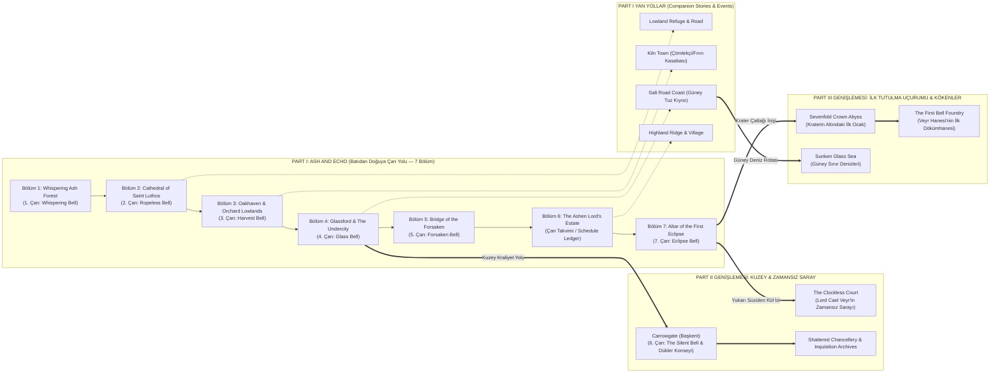

# Veyrhold Dünya Atlası, Genişleyebilir World Map Mimarisi ve Project Genie (Genie 3) Üretim Rehberi

Bu doküman, **Unaware of My Demise** evreninin (**Veyrhold Krallığı**) bütünsel coğrafyasını, **Part I: Ash and Echo** kapsamındaki 7 Bölüm (Chapter) + Yan Yol (Side Road) düğümlerini, **Part II ve Part III** ile açılacak genişleme bölgelerini, **Project Genie (`https://labs.google/fx/projectgenie/tr/tools/projectgenie/creation`)** ile etkileşimli 3B/2.5B dünya üretimi iş akışını ve **Google AI Ultra** video stüdyolarını (**Google Flow** & **Whisk Animate**) tanımlar.

---

## 🎬 1. Google AI Ultra Planındaki Video ve Dünya Üretim Araçları

| Araç Adı | Resmi Adres (URL) | Motor / Teknoloji | Oyundaki Kullanım Amacı |
|---|---|---|---|
| **Google Flow** *(Aradığın Video Stüdyosu)* | `https://labs.google/fx/tools/flow` *(TR: `https://labs.google/fx/tr/tools/flow`)* | **Veo 3.1 + Imagen 4** (Scenebuilder, Ingredients, First/Last Frame, Camera Controls) | **Ana Sinematik Video Üretim Sitesi:** Filigransız 1080p ara sahneler (Cutscene), ~120 saniyelik *Before the Road* Prologue açılış videosu, 5★ *First Oath* Gacha çağrı (Summon) animasyonu ve Boss faz geçiş (Phase II Cut-in) videoları. |
| **Project Genie** | `https://labs.google/fx/projectgenie/tr/tools/projectgenie/creation` | **DeepMind Genie 3** (Gerçek Zamanlı 720p@24fps Etkileşimli Dünya Modeli) | **Etkileşimli Dünya & Kamera Keşif Stüdyosu:** Tek bir `16:9` Seed görselinden veya mekan prompt'undan yürünebilir 3B/2.5B sahne üretir. İçinde kamerayı yürüterek aynı mekana ait farklı **VN konuşma açıları**, **Cutscene kamera dolly/pan açıları**, **5v5 Savaş Arenası (Battle Stage)** perspektifleri ve **3 katmanlı Parallax (`fg / mid / bg`)** katmanları çıkarılır. |
| **Google Whisk & Whisk Animate** | `https://labs.google/fx/tools/whisk` | **Imagen 4 + Veo Döngü Motoru** (Subject + Scene + Style kilitleme) | **Canlı Lobi & Portre Döngüleri (Loop):** Sanctum kamp ekranı, karakter inceleme ekranı ve dünya haritası üzerindeki nefes alma, pelerin dalgalanması, fener titremesi ve kül yağışı döngüleri. |

---

## 🗺️ 2. Veyrhold Krallığı: Genişleyebilir Dünya Haritası (World Map) Mimarisi

Veyrhold Krallığı, yaşayanların saatlerini sayan ve ölülerin geri dönmesini engelleyen **Yedi Çan (Seven Bells / The Law of Hours)** etrafına kurulmuş feodal bir coğrafyadır. Dünya haritası (`World Map`), merkezdeki **Batı-Doğu Çan Yolu (Part I Rotası)** ekseninden başlayıp, **Kuzey (Part II)** ve **Güney/Doğu Krater Derinlikleri (Part III)** yönlerine doğru modüler olarak genişleyecek şekilde tasarlanmıştır:

---

## 🧭 3. Part I: Bölüm Bölüm (Chapter 1–7) Mekanlar, Sahne Türleri ve Project Genie Seed Paketleri

Her bölüm (Chapter), **Project Genie** içinde tek bir ana **Merkez Tohumdan (Hub Seed)** üretilip kamera yürüyüşüyle alt sahnelere (Cutscene, VN Diyalog, Kamp ve 5v5 Savaş Sahnesi) ayrılacak şekilde yapılandırılmıştır:

---

### BÖLÜM 1 — Whispering Ash Forest (`forest_whispering_ash`)
- **Bölge & Çan:** Batı Orman Yolu · **1. Çan: The Whispering Bell** (Çatlak; bir parçası `boss_ash_maw`'ın çenesine kaynamıştır).
- **Görsel Kural & Atmosfer (`ORDER_LEVEL`):**
  - *Ordered:* Yol açık, ağaç gövdelerine kazınmış isimler okunaklı, yol kenarı tapınağı (`Wayshrine`) sağlam, hafif sis.
  - *Uneasy:* Yola devrilmiş birkaç kütük, kazınmış isimler silikleşmiş, yoğun sis, **aşağı değil yukarı doğru süzülen** soluk kül taneleri.
  - *Chaotic:* Yol devrilmiş ağaçlarla kapalı, tapınak çatısı çökmüş, çan oyuğu çatlak, ağaçlarda ince kızıl kehanet izleri.
- **Bu Bölgeden Türetilecek Sahne Arka Planları:**
  1. `forest_whispering_ash` (Ana Yol & Wayshrine — VN, 1-1..1-4 Savaş ve İlk Yemin `ch1_first_oath` Cutscene)
  2. `ch1_camp` (Tapınak sundurması altındaki sıcak fenerli kamp alanı)
  3. `forest_boss_clearing` (1-5 `The Ash-Maw` Boss Savaş Arenası — Kırık çan kaidesi açıklığı)
  4. `forest_edge_road` (Bölüm 2'ye bağlanan orman çıkışı yolu)
- **Project Genie (`projectgenie/creation`) Promptu:**
  > `Dark gothic anime 2.5D/3D navigable environment. Damp cobblestone forest road winding through ancient pale-grey ash trees whose pale leaves drift like falling ash, mossy dark pine undergrowth, rain-slicked mud, low ground fog. On the right stands a weathered stone roadside wayshrine with a swept doorstep, an interior wooden name-register board, an empty cracked bell niche under its eave, and one warm amber shuttered lantern. In the far distance rises the gothic spire of Saint Luthos Abbey against a slate-plum twilight sky.`
- **Seed Görseli:** [`ch01_forest_whispering_ash_seed_v001.jpg`](../15_Art_Workbench/locations/ch01_forest_whispering_ash/design_v001/ch01_forest_whispering_ash_seed_v001.jpg)

---

### BÖLÜM 2 — Ruined Cathedral of Saint Luthos (`cathedral_saint_luthos`)
- **Bölge & Çan:** Orman Sınırı Çukur Ova · **2. Çan: The Ropeless Bell** (İpsiz ve dilsiz olduğu halde kendi kendine çalan kule çanı).
- **Görsel Kural & Atmosfer:** Kırık gül pencere (`rose window`), gri gökyüzünü yansıtan su basmış taş nef (`flooded nave`), taş çıkıntılarda yanan mum sıraları, halatsız çan kulesi. Palet: Soğuk taş grisi, Dawn-altın mum ışığı, derin lacivert gölge.
- **Bu Bölgeden Türetilecek Sahne Arka Planları:**
  1. `cathedral_saint_luthos` (Su basmış ana nef — VN diyalog ve 2-1..2-4 Koro Şövalyesi savaşları)
  2. `cathedral_belfry_altar` (2-5 **Lady Yseldra Vale / The Bell-Widow** Boss Savaş & Cutscene sahnesi — İpsiz çanın altındaki yüksek sunak)
  3. `ch2_camp` (Yıkık yan şapel, kuru taş seki ve mumlarla çevrili kamp alanı)
- **Project Genie (`projectgenie/creation`) Promptu:**
  > `Dark gothic anime 3D navigable ruined cathedral interior. Ankle-deep still floodwater covering the cracked stone nave floor reflecting vaulted gothic colonnades, rows of lit white votive candles on stone ledges, a massive shattered rose window in the rear casting cold silver-blue moonlight across warm Dawn-gold candlelight, and an open stone belfry arch overhead where a giant bronze bell hangs with no rope.`
- **Seed Görseli:** [`ch02_cathedral_saint_luthos_seed_v001.jpg`](../15_Art_Workbench/locations/ch02_cathedral_saint_luthos/design_v001/ch02_cathedral_saint_luthos_seed_v001.jpg)

---

### BÖLÜM 3 — Oakhaven (`village_oakhaven`)
- **Bölge & Çan:** Meyve Bahçesi Ovaları (`Orchard Lowlands`) · **3. Çan: The Harvest Bell** (Jori Flint'in ocağında yeniden dökülmüş olmasına rağmen saymaya devam eden çan).
- **Görsel Kural & Atmosfer:** Taş bahçe duvarları, dallarında hâlâ koyu kırmızı elmalar duran yapraksız elma ağaçları, tepede yel değirmeni, köy kuyusu, meydanda rüzgârda kuruyan beyaz çarşaflar, kapılarda **yazıları silinmiş boş ahşap isim levhaları**. Palet: Toprak sarısı (ochre), soluk yosun yeşili, beyaz keten, alacakaranlık gül kurusu.
- **Bu Bölgeden Türetilecek Sahne Arka Planları:**
  1. `village_oakhaven` / `oakhaven_square` (Köy meydanı, kuyu ve boş isim levhaları — VN & 3-1..3-4 Savaş sahnesi)
  2. `oakhaven_inn` (Bölüm 3 Kamp alanı, Pippa Bell & Hasat Yemeği etkinlik sahnesi)
  3. `oakhaven_forge` (Jori Flint ve Garrick Cinder'ın demirhane/dökümhane ocağı)
  4. `orchard_lowlands` (3-5 **Captain Rusk** Boss Savaş & Düello Kavşağı — Yanan elma bahçesi yolu)
- **Project Genie (`projectgenie/creation`) Promptu:**
  > `Dark gothic anime 3D navigable rural village at dusk. Low stone orchard walls, bare twisted apple trees with dark red fruit still on the branches, timber houses with blank erased wooden nameplates by the doors, a cobbled village square with a stone well, white linen sheets drying on lines, a warm glowing blacksmith forge on the left, and a weathered wooden windmill on the hill against an ochre and dusk-rose sky.`
- **Seed Görseli:** [`ch03_village_oakhaven_seed_v001.jpg`](../15_Art_Workbench/locations/ch03_village_oakhaven/design_v001/ch03_village_oakhaven_seed_v001.jpg)

---

### BÖLÜM 4 — The Undercity beneath Glassford (`undercity_subterranean`)
- **Bölge & Çan:** Nehir Şehri **Glassford**'un Altındaki Yeraltı Sarnıçları · **4. Çan: The Glass Bell** (Red Vial Loncası'nın zamanı süzmek için kullandığı en alt sarnıç çanı).
- **Görsel Kural & Atmosfer:** Drenaj kanalları, kehribar ışıklı mantar lambalar, durgun sarnıç suyu, depo kapısı ardındaki gizli klinik koğuşu, bakır damıtma boruları. Palet: Deniz mavisi-siyah (teal-black) su, mantar kehribarı, nemli taş.
- **Bu Bölgeden Türetilecek Sahne Arka Planları:**
  1. `river_city_gates` (Glassford nehir kapıları ve yeraltı girişi — Bölüm 4 Yol & Kamp)
  2. `undercity_subterranean` / `undercity_cistern` (Ana sarnıç kanalları ve kemerli köprüler — 4-1..4-4 Savaş sahnesi)
  3. `undercity_red_vial_ward` & `undercity_antidote_archive` (Gizli klinik koğuşu, panzehir arşivi ve 4-5 **The Red Vial Matron** Boss Laboratuvarı)
- **Project Genie (`projectgenie/creation`) Promptu:**
  > `Dark gothic anime 3D navigable subterranean cistern city beneath a river metropolis. Vaulted damp stone arches, still teal-black drainage canals reflecting warm amber bioluminescent mushroom lamps, brass alchemical distillation pipes running along the walls, stone walkways with iron railings, and a hidden clinic door glowing softly at the far end.`
- **Seed Görseli:** [`ch04_undercity_subterranean_seed_v001.jpg`](../15_Art_Workbench/locations/ch04_undercity_subterranean/design_v001/ch04_undercity_subterranean_seed_v001.jpg)

---

### BÖLÜM 5 — Bridge of the Forsaken (`bridge_forsaken`)
- **Bölge & Çan:** Doğu Uçurumu (`Eastern Ravine`) · **5. Çan: The Forsaken Bell** (Sable Wren tarafından susturulan işaret kulesi çanı).
- **Görsel Kural & Atmosfer:** Sislerle dolu derin bir uçurumun üzerindeki devasa taş kuşatma köprüsü, yırtık sancaklar, terk edilmiş kuşatma vinçleri ve ağır demir zincirler, yüksek işaret kulesi (`signal tower`). Palet: Sis beyazı, arduvaz grisi (slate), paslı demir, mat oxblood.
- **Bu Bölgeden Türetilecek Sahne Arka Planları:**
  1. `bridge_forsaken` / `bridge_gate` (Ana taş köprü açıklığı ve demir parmaklıklı kapı — 5-1..5-5 **Marshal Oren** Boss Savaş & Cutscene sahnesi)
  2. `bridge_signal_tower` (Sable Wren, Rikka Ember ve Corbin Locke'un işaret kulesi mekanizması sahnesi)
  3. `bridge_far_bank` & `eastern_ravine_road` (Köprünün karşı yakasındaki kamp alanı ve doğu uçurum yolu)
- **Project Genie (`projectgenie/creation`) Promptu:**
  > `Dark gothic anime 3D navigable colossal fortified stone bridge spanning a deep fog-filled ravine in cold rain. Weathered slate-grey masonry, abandoned iron siege winches and heavy hanging chains, torn oxblood royal banners flapping in the wind, a rusted portcullis gatehouse, and a tall stone signal tower rising into the white mist.`
- **Seed Görseli:** [`ch05_bridge_forsaken_seed_v001.jpg`](../15_Art_Workbench/locations/ch05_bridge_forsaken/design_v001/ch05_bridge_forsaken_seed_v001.jpg)

---

### BÖLÜM 6 — The Ashen Lord's Estate (`estate_ashen_lord`)
- **Bölge & Çan:** Doğu Yaylaları (`Eastern Highlands`) · **Çan Yok — Çanların Takvim Defteri (`The Schedule Ledger`) burada saklıdır.**
- **Görsel Kural & Atmosfer:** İs karası soylu malikânesi, isim plakaları kesilip sökülmüş portre galerisi (`ashen_estate_gallery`), çatlak camlı kış bahçesi (`ashen_estate_conservatory`), yarı çökmüş arşiv ve hizmetkâr kanadı. Palet: İs siyahı, kararmış altın (tarnished gold), soğuk cam mavisi-yeşili (cold glass teal).
- **Bu Bölgeden Türetilecek Sahne Arka Planları:**
  1. `estate_ashen_lord` / `ashen_estate_ruins` (Malikâne dış avlusu ve yıkık giriş — Bölüm 6 Kamp & 6-1..6-2 Savaş)
  2. `ashen_estate_gallery` (İsim plakaları sökülmüş dev portre galerisi — 6-5 **The Ashen Lord's Wraith** Boss Savaş & Cutscene sahnesi)
  3. `ashen_estate_conservatory` (Çatlak camlı kış bahçesi — Vespera, Thistle, Tilda ve Rowan sahneleri)
  4. `ashen_estate_servants_wing` (Hizmetkârlar kanadı — Hana Birch, Clem Marr, Sable Wren sahneleri)
- **Project Genie (`projectgenie/creation`) Promptu:**
  > `Dark gothic anime 3D navigable aristocratic manor gallery and conservatory. Soot-black stone walls with tarnished antique gold moldings, tall portrait frames whose brass nameplates have been chiseled off, draped white dust sheets over furniture, floating mirror shards, and a adjoining cracked-glass conservatory glowing with cold glass-teal moonlight and drifting silver ash.`
- **Seed Görseli:** [`ch06_estate_ashen_lord_seed_v001.jpg`](../15_Art_Workbench/locations/ch06_estate_ashen_lord/design_v001/ch06_estate_ashen_lord_seed_v001.jpg)

---

### BÖLÜM 7 — Altar of the First Eclipse (`altar_first_eclipse`)
- **Bölge & Çan:** Doğu Dağları Taç Krateri (`Crown-Shaped Crater`) · **7. Çan: The Eclipse Bell** (`The Eclipse Construct / The Hinge` içerisine inşa edilmiş çan).
- **Görsel Kural & Atmosfer:** Taç şeklinde devasa dağ krateri, yedi kırık dev çan zinciri, dairesel siyah taş sunak, üç ayaklı pirinç-taş Pylon sütunları ve gökyüzünde hiç hareket etmeyen **kızıl halkalı siyah güneş tutulması** (oyunda kızıl rengin ana odak olmasına izin verilen tek kutsal/uğursuz yer). Palet: Siyah bazalt taş, kül grisi, kızıl tutulma halkası, soğuk Veil moru.
- **Bu Bölgeden Türetilecek Sahne Arka Planları:**
  1. `mountain_lower_pass` & `mountain_crater_rim` (Krater eşiği ve dağ geçidi — Bölüm 7 Yol & Yoldaş Hikâyeleri)
  2. `altar_first_eclipse` (7-5 **The Eclipse Construct / The Hinge** Final Boss Savaş Arenası — Üç Pylonlu siyah taş sunak)
  3. `altar_first_eclipse_outer_dais` (`part1_emotional_confession` — Mahmut & Fadyme duygusal itiraf Cutscene sahnesi)
  4. `altar_first_eclipse_reflection` (`part1_clockless_reveal` — **Lord Cael Veyr** kırık ayna ve yukarı süzülen kül final twist Cutscene sahnesi)
- **Project Genie (`projectgenie/creation`) Promptu:**
  > `Dark gothic anime 3D navigable monumental mountain crater sanctuary. A crown-shaped jagged black-stone crater rim, seven colossal broken bronze bell chains spanning the abyss, a circular black-stone altar platform at the center flanked by three freestanding bronze tripod pylons glowing with Veil-violet runes, and directly overhead in the dark sky hangs an unmoving black solar eclipse ringed in burning crimson light.`
- **Seed Görseli:** [`ch07_altar_first_eclipse_seed_v001.jpg`](../15_Art_Workbench/locations/ch07_altar_first_eclipse/design_v001/ch07_altar_first_eclipse_seed_v001.jpg)

---

## 🛠️ 4. Project Genie'den Oyuna Sahne & Arka Plan Çıkarma İş Akışı

1. **Adım 1 — Tohum Yükleme (`Seed Upload`):**
   `narrative/15_Art_Workbench/locations/` altındaki `16:9` Bölüm Tohum Görselini (`ch01`..`ch07`) ve yukarıdaki **Project Genie Promptunu** `https://labs.google/fx/projectgenie/tr/tools/projectgenie/creation` ekranına gir.
2. **Adım 2 — Kamera Yürüyüşü ile Alt Sahne Yakalama (`Camera Exploration`):**
   Genie 3 dünyayı oluşturduğunda klavye/kamera kontrolleriyle:
   - **Savaş Sahnesi (Battle Stage) İçin:** Kamerayı yan-cepheden (`side-view / slight low angle`) geniş bir açıklığa hizalayıp sol yarıda 5 kahraman, sağ yarıda düşman/boss duracak şekilde (`zemin ufuk çizgisi ekranın alt %30-%35'inde`) kare yakala.
   - **VN / Diyalog Sahnesi İçin:** Odak noktasına (Wayshrine, Kuyu, Sarnıç Kapısı, Portre Galerisi) doğru ileri dolly (`forward dolly`) yaparak orta-plan kare yakala.
   - **Cutscene / Ara Sahne İçin:** Kamera hareketini (pan/tilt/dolly) video olarak dışa aktar veya **Google Flow (`labs.google/fx/tools/flow`)** içinde *First Frame / Last Frame* referansı olarak kullan.
3. **Adım 3 — Parallax Katmanlama (`Unity 6 URP 2D Stage`):**
   Yatay kamera kaydırmasından (`lateral truck`) elde edilen kareleri 3 katmana (`bg_sky_horizon`, `mid_architecture`, `fg_mist_props`) ayırarak oyun motorundaki sahne derinliğine bağla.
