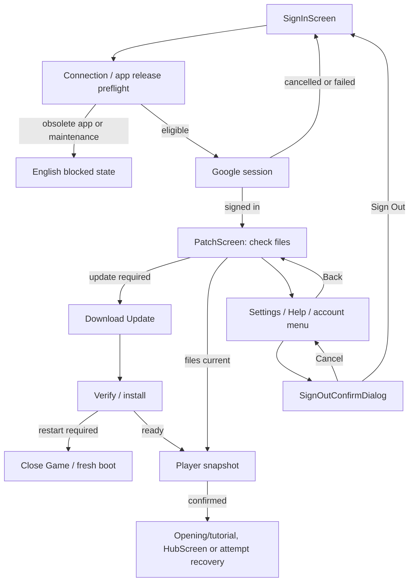

# Entry flow — SignInScreen / PatchScreen / utilities

2026-10-05 · DESIGN_DRAFT / V03. Player UI and subtitles: **English**. Voice acting: **Japanese**. The owner corrected the earlier Turkish UI draft; [LANGUAGE_POLICY.md](LANGUAGE_POLICY.md) applies from the first screen. Historical v01/v02 previews are not current acceptance evidence.

The entry prototype uses approved logo-bearing key art without changing its bytes. The composition stays contained above the actual control height, preserving characters and logo. Colors remain ink, bone and brass. Settings and Help use a quiet solid background for readable scrolling.

## Registered pages and components

| Name | Stable ID | Purpose |
|---|---|---|
| SignInScreen | `ui.sign_in` | English Google sign-in and release/auth outcomes |
| PatchScreen | `ui.patch` | Signed-in update gate; no playable content dependency |
| EntrySettingsScreen | `ui.entry_settings` | Local audio, accessibility and fixed language rows |
| EntryHelpScreen | `ui.entry_help` | Shipped connection/update help and privacy entry |
| EntryUtilityMenu | `ui.entry_utility_menu` | Top-right Settings / Help / Sign Out |
| SignOutConfirmDialog | `ui.sign_out_confirm` | Cancel or sign out; preserve account/progress |

[SCREEN_REGISTRY.json](SCREEN_REGISTRY.json) defines each spec, view, proposed Godot scene/script path, access condition and intent signals. [screens/](screens/README.md) contains the per-page handoff. These are proposed integration targets; no .tscn or runtime code is added here.

## Flow

Pre-patch utilities use only shipped UI/help/device preferences and session presence. They do not need roster, wallet, lore or a snapshot. Settings and Help stay accessible while a patch continues; navigation does not start another operation. Sign Out is session-only, confirms explicitly and invalidates late operation results. Installed verified content and device preferences stay; server account/progress is not deleted.

## Current technical mapping and required bindings

Main `10b42fb` also has TitleScreen with early-tap/loading ownership and the first-player opening route from [FIRST_LAUNCH_FLOW.md](../../docs/design/FIRST_LAUNCH_FLOW.md). SignInScreen is a separately named credential page. Native Credential Manager / SignInFlow, Online, ClientRelease, ContentInstaller, AssetResolver and AudioDirector exist. `Game.attach` checks release before auth; a content mismatch invokes the update path, where `Game.update_content` signs in before the authenticated content release. The proposed session/patch pages can wrap that order, while app-version/maintenance preflight still blocks early. Current patch/error boot surfaces still use MessageScreen and have not adopted this design.

Godot integration must separate page navigation from operation ownership, expose actual download byte progress when available, add a controlled cancellation boundary for sign-out, respect atomic install publication, and bind local settings to shared app preferences. Preserve existing app-update priority, signed manifest verification, partial-file resume, restart requirements and first-opening/Hub/attempt recovery behavior. The technical team's first-player opening is preserved; this design changes no runtime, story or economy. Flow audio slots now exist in `audio_cues_part1.json` with null values; cue assignment remains a separate Narrative step, and the owner supplies any main theme.

## Review prototype

[entry/index.html](entry/index.html) has 13 local flow scenarios. Hash routes: `#sign-in`, `#patch`, `#settings`, `#help`. An unsigned `#patch` link returns to SignInScreen. The explicit review-only `?scenario=content&preview=patch#patch` URL seeds a signed-in sample for direct visual inspection; it does not authenticate anyone.

Download and verification are timers, never real transfers. Unknown-byte progress stays indeterminate. The successful review transition links to the earlier English Hub wireframe with sample roster/wallet, not the real first-player opening. `Close Game` resets the review; Godot will quit/restart. The real store target is already in StoryDirector; the review keeps external store launching disabled and shows an unavailable outcome. Legal policy text/URL awaits D-15. Help includes the owner-approved support mail address. LocalStorage contains device preferences only; no Google/player data. Audio is not played.

Active images are `ui_sign_in_screen_v003.png`, `ui_patch_screen_v003.png`, `ui_entry_settings_screen_v003.png`, `ui_entry_help_screen_v003.png`, `ui_entry_utility_menu_v003.png`, `ui_sign_out_confirm_dialog_v003.png`. [ENTRY_VERIFICATION.json](ENTRY_VERIFICATION.json) records current browser checks; [archive/ENTRY_VERIFICATION_v002.json](archive/ENTRY_VERIFICATION_v002.json) preserves the old check. Browser review is not Android/Godot/account acceptance.
