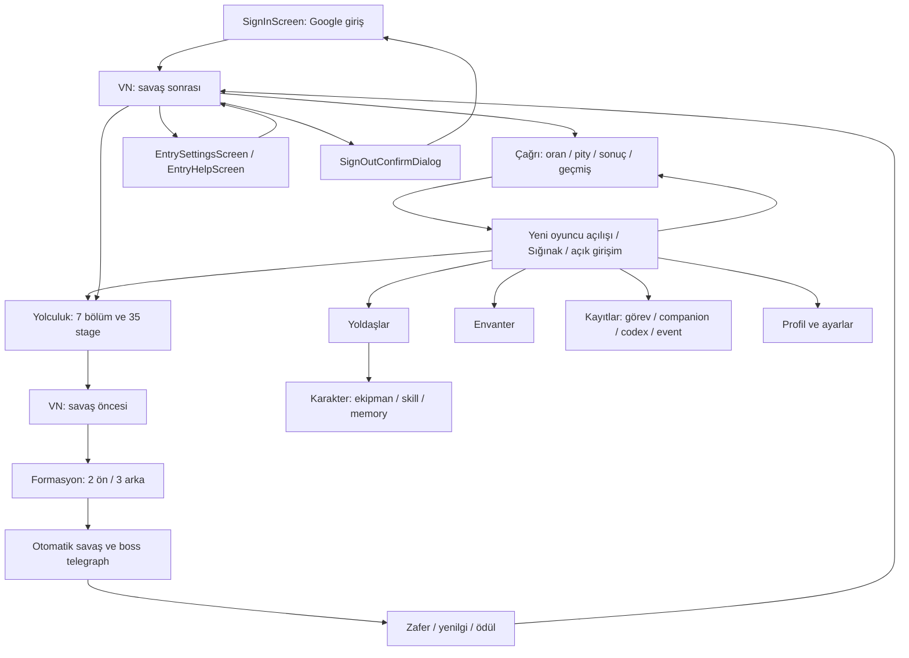

# UOMD — Ekran Haritası v1
Durum: DESIGN_DRAFT. Giriş/patch/araç sayfaları v03 ve ana menü görsel adayı. Oyuncu metinleri İngilizce, ses Japonca. [Sayfa adları ve Godot hedefleri](SCREEN_REGISTRY.json).

## Ana akış

## Kapsam ve bağımlılıklar
| Ekran | Yerleşim / amaç | Mevcut bağlantı | Tasarım durumu |
|---|---|---|---|
| SignInScreen | Marka, Google CTA, release/auth durumları | SignInFlow, Native Credential Manager, Online, ClientRelease | [v03](screens/sign_in_screen.md); İngilizce, Godot binding bekliyor |
| PatchScreen | Giriş sonrası içerik kontrolü/indirme, doğrulama ve retry | Game.update_content / ContentInstaller; progress/cancel binding bekliyor | [v03](screens/patch_screen.md); patch öncesi ve sırasında araçlar açık |
| EntrySettingsScreen / EntryHelpScreen | Cihaz ayarları, EN/JA bilgi, bağlantı/patch yardımı | AudioDirector / yerel tercihler; shipped UI bağımsızlığı | [Ayrı sayfalar](screens/README.md) |
| EntryUtilityMenu / SignOutConfirmDialog | Sağ üst Settings/Help/Sign Out; oturum kapatma onayı | Online.log_out + operation cancellation boundary | [Kayıtlı bileşenler](SCREEN_REGISTRY.json) |
| Sığınak | Kaynaklar, mekân hotspotları, büyük devam kartı, 5 tab | HubScreen + StoryDirector | Ayrıntılı görsel aday |
| Yolculuk | 7 chapter kartı; mevcut chapter 5 node, kilit/clear/current | StoryIndex + chapter/stage JSON | Etkileşimli yerleşim |
| Stage detayı | Tavsiye Lv, Ration, düşman/ödül özeti, hazırlan | stage JSON + begin_stage | Sheet |
| İlk Yemin | 4★ hero seçimi, guest/owned farkı, tek seçim | SelectorScreen | Blueprint; mevcut seçim değiştirilmez |
| Formasyon | 2 front/3 rear slot, roster alt listesi, start | RosterScreen | Etkileşimli yerleşim |
| Savaş | İki sıra, düşman, HP/status, turn/log, hız/skip | BattleScreen/BattlePlayback | Yerleşim ve sonuç taslağı |
| Zafer / yenilgi | Açık sonuç, server-confirmed ödül, retry/retreat | GameFlow/DefeatScreen | Modal |
| Yoldaşlar | 20 roster tanımı; owned/locked, arama/element | TeamScreen + character JSON | Etkileşimli yerleşim |
| Karakter detayı | Portre, element/role, level, equipment, skill, memory | Team/Skills/Inventory | Etkileşimli yerleşim |
| Envanter | İkonlu öğeler, kategori, detail, equip/upgrade | InventoryScreen | Etkileşimli yerleşim |
| Çağrı | Artwork, banner türleri, pity/rate, 1/10, açık onay | GachaScreen | Etkileşimli yerleşim |
| Çağrı sonucu/geçmiş | Yeni/duplicate, shards, düzenli geçmiş | gacha results/history API | Sonuç sheet / blueprint |
| Görevler | Günlük/haftalık ayrım, ready/claimed/locked | QuestsScreen | Etkileşimli yerleşim |
| Han | +30 Ration, claimed state ve 100 üstü grant | claim_inn_meal API | Sheet |
| Companion | Karakter bazlı parçalar, spoiler unlock | kaynak 76 part; runtime tüketici eksik | Kayıtlar yerleşimi |
| Codex | Kategoriler, ilerlemeye bağlı kilitler | kaynak unlock/runtime farkı | Kayıtlar yerleşimi |
| Events | 4 mevcut narrative event, erişim/ödül | event JSON; schedule/integration kararı | Blueprint; guild event sosyal guild sistemi varsaymaz |
| VN | Background, portrait, subtitle, Auto/Log | VnScreen, AssetResolver, AudioDirector; cue/asset kapsam farkları | Etkileşimli yerleşim |
| Profil / ayarlar | Hesap, ses/müzik/VO, metin, motion, sign-out | Settings/Online; hesap işlemleri eksik | Etkileşimli ayar yerleşimi |
| Kaynaklar / hata / loading | Chip sheet, retry, disabled/empty | Outcome ve PlayerState | Ortak bileşen |

## Ana menü anatomisi
1. Üst güvenli alanda küçük profil ve kaynak satırı: Crowns, Eclipse Tokens, Fate's Threads; Ration ayrı okunabilir sayaç.
2. Sığınak başlığı ve bir satırlık atmosfer; sahne artwork'ünü kaplamayan kompakt görev/ayar kısayolları.
3. Avluda üç okunabilir mekân: Yemin sunağı → Çağrı; sıcak han → Inn Meal; tezgâh → Envanter. En az 44 px tıklama alanı ve keyboard/focus.
4. Alt gövde: bulunduğun chapter/stage, önerilen Lv, ilerleme ve bir “Yola Devam Et” CTA. Fadyme'nin mektubu gibi spoiler nesneleri hub'da önden açılmaz.
5. Kalıcı alt navigasyon. Sahne artwork ve navigation ayrı katmanlar; metin görsele basılmaz.

## Veri kuralları
Demo stage 1-5, roster 5 örnek sahip olunan yoldaş, örnek cüzdan: canlı oyuncu durumu değildir. Skill ve chapter/stage adları mevcut JSON'dan gelir. Oyuncu metni/altyazı İngilizce, ses Japonca; Narrative replik çevirisi yapılmaz. Gerçek server authority, currency/pity ve oyuncu state persistence bu taslakta yoktur.

## Uygulama sırası
İlk giriş → Sığınak + ortak tasarım sistemi → Yolculuk/formasyon/savaş → Yoldaşlar/envanter/skills → Çağrı/görevler → Kayıtlar/VN/ayarlar → tüm durumlar ve Android doğrulaması. Seçili Narrative kaynak aktarımı tamamlandı; kaynak/runtime farklarını kapatma ayrı izlenir.
