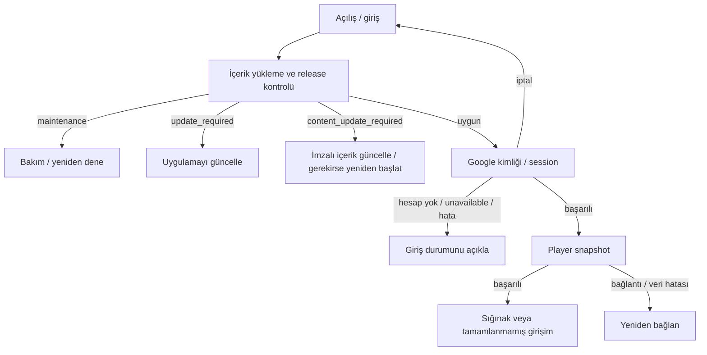

# UI / 01 — İlk oyuna giriş ekranı

2026-10-05 · DESIGN_DRAFT / V02. Narrative seçici kaynak aktarımı `395c4b9` / BATCH-0005 ile main'e gönderildikten sonra hazırlanmıştır. Bu çalışma giriş arayüzünü ve durum akışını tasarlar; Godot boot/login kodunu değiştirmez.

## Görsel öneri
Onaylı `brand_key_art_portrait_r2_v003_with_logo.png` ekranda Mahmut/Fadyme ve marka ile birlikte kullanılır. Kaynak dosya/pixeller değiştirilmez. Logo tek başına yeşil-key RGB olduğundan doğrudan transparanmış gibi bindirilmez; mevcut onaylı kompozisyon kullanılır. Dar telefonda logo ve karakterlerin tamamı contain yerleşiminde kalır. Durum kartı büyüdüğünde artwork alanı gerçek kart yüksekliğine göre küçülür; kart logonun üzerine binmez.

Üstte küçük Part I etiketi ve ses düğmesi; resmin altında sakin bir satır, tek Google CTA; altta Gizlilik/Yardım. Alt ana navigasyon, cüzdan ve mağaza kısayolları giriş ekranında yok. Koyu zemin, kemik metin ve pirinç vurgu ortak tasarım dilidir. Google butonu kendi tanınır beyaz zemini/rengiyle ayrılır.

İlk giriş: “Google ile Devam Et”. Geri dönen oyuncu: “Devam Et”; aynı account ile tekrar bağlanır. Cihazda kalıcı server session varmış gibi mesaj yazılmaz: güncel `Online` session'ı bellekte tutar; Native Credential Manager remembered choice ile silent/auto-select çalışabilir.

## Akış ve mevcut teknik eşleme

- `StoryDirector.start` / `_on_flow_loaded`: local content load ve boot yüzeyi.
- `Game.attach`: önce release gate, sonra Google session, sonra snapshot. Prototip aşamaları bu sırayı takip eder.
- `ClientRelease`: bakım, uygulama güncellemesi ve içerik güncellemesi ayrı. Uygulama update zorunluluğu maintenance'tan önce gelir.
- `SignInFlow` / `Online.sign_in`: Google nonce/token/session; `cancelled`, `no_account`, `unavailable`, başarısız giriş.
- `ContentInstaller` / `Game.update_content`: signed pack, doğrulama, mount/restart; görsel progress gerçek byte bilgisi yokken yüzde uydurmaz.
- Server snapshot sonrası mevcut director davranışı korunmalı: Sığınak veya açık attempt recovery. Yeni hesapta ilk hikâyeyi otomatik başlatmak bu taslakla sessizce eklenmez.

## Durumlar
| Durum | Oyuncunun gördüğü | Ana eylem |
|---|---|---|
| İlk giriş | Artwork + Google butonu | Google ile Devam Et |
| Dönen oyuncu | “Yol seni bekliyor” | Devam Et |
| Release / giriş / sync bekliyor | Kısa durum + belirsiz progress | Geri dön; ikinci gönderim engelli |
| Bağlantı yok | “Bağlantı kurulamadı” | Yeniden Dene |
| Google iptal | “Giriş tamamlanmadı”; hata alarmı yok | Girişe Dön |
| Hesap yok | Cihaza Google hesabı ekleme bilgisi | Yeniden Dene |
| Unavailable | Bu cihazda giriş kullanılamıyor | Yeniden Dene |
| Maintenance | “Kısa bir mola”; gerçek server mesajı | Yeniden Dene |
| App update | “Yeni sürüm hazır” | Doğrulanmış mağaza linki |
| Content update | “Yol hazırlanıyor” | Verileri Güncelle |
| Snapshot hatası | “Yolculuğun yüklenemedi” | Yeniden bağlan |
| Hazır | Sığınağa / recovery'ye geçiş | Devam Et |

Geri dön/iptal sonrasında geç tamamlanan async sonuç eski ekranı açmamalı. Uygulamada in-flight operation ve boot ownership ile sağlanır; taslakta epoch guard bu davranışı gösterir. Backend veya token işlemi yapmaz.

## Prototip ve kaynaklar
[entry/index.html](entry/index.html) ayrı etkileşimli giriş taslağıdır. Masaüstü sol panelinden 10 senaryo seçilir; telefonda `?scenario=offline` gibi URL ile aynı durum incelenir. Google butonu gerçek hesabı açmaz. Başarılı örnek akış, önceki Sığınak prototipine bağlanır; oradaki örnek beş kişilik roster gerçek yeni oyuncu başlangıcı değildir.

Ses düğmesi mute görsel durumunu gösterir; müzik oynatmaz. Ana tema kullanıcıya aittir. Gizlilik ve store linki yayın sürümündeki gerçek adreslere bağlanacak; prototip sahte politika, OAuth/client ID, token veya mağaza URL'si üretmez. Yardım sheet'i ve keyboard focus çalışır; reduced-motion tercihinde spinner hareketi kapalıdır.

Korunan asset: `narrative/references/key_art/brand_key_art_portrait_r2_v003_with_logo.png`, SHA-256 `896f77249416` ile başlayan mevcut lock kaydı. Yeni opening artwork/karakter tasarımı üretilmedi. Türkçe metinler UI localization taslağı; Narrative replik çevirisi değildir.

Sonraki üretim işi: görsel değerlendirme → Godot title/boot Control yerleşimi → gerçek release/login/snapshot outcome binding → Android Back/safe-area/metin ve durum doğrulaması. Native Google giriş altyapısı main'de mevcuttur; OAuth/publication readiness ayrı teknik owner kararlarıyla izlenir.
